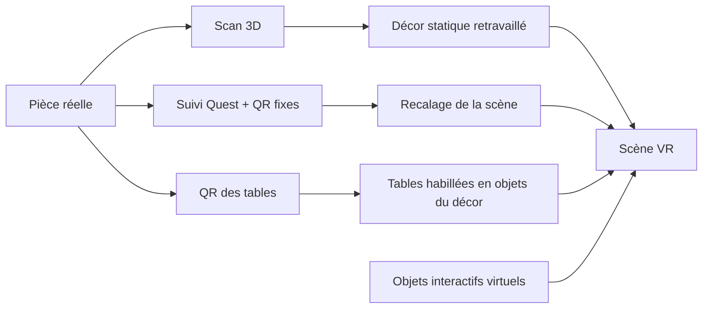

# Tohannic: No Way Out

> Escape game en **VR alignée avec une vraie pièce**, développé sur **Meta Quest 3**.

## Le concept

Le joueur explore une version virtuelle de la salle dans laquelle il se trouve. Le thème actuellement retenu est une **salle d'alchimie médiévale fantasy low-poly**. Les dimensions et la position des éléments physiques doivent rester cohérentes avec cette représentation virtuelle.

## Fonctionnement général

## Les choix retenus

- **Une seule pièce** pour commencer, sans couloir obligatoire.
- **VR** pour l'affichage principal. La MR reste une extension.
- Scan 3D de la salle, sans intégrer définitivement les tables mobiles au décor.
- Suivi spatial natif du Quest, complété par les **QR codes fixes** pour recaler la pièce au fil de l'utilisation.
- Détection des **tables par leurs propres QR codes avant chaque partie**. Leur position peut changer d'une partie à l'autre.
- Chaque table est **remplacée visuellement par un modèle adapté au thème du décor**, dès le MVP 1.
- Objets à manipuler **uniquement virtuels**. Les interactions exactes restent à valider.
- Environnement sombre, ambiance sonore et torche virtuelle dès le MVP 1.
- Items physiques avec collisions et interactions avec l'environnement, indépendamment du monstre.
- Mode `Peaceful` jouable sans monstre.

## Les deux MVP

| MVP                 | Objectif                                                                                                     |
| ------------------- | ------------------------------------------------------------------------------------------------------------ |
| **MVP 1 — INF3001** | Salle VR alignée, tables détectées et transformées visuellement, objets interactifs et courte boucle de jeu. |
| **MVP 2 — INF3002** | Monstre animé, perception visuelle et auditive, réactions aux collisions, mémoire, FSM et navigation.        |

Le déroulement détaillé est dans la [roadmap](roadmap.md).

## Documentation

- [Architecture](architecture.md) — les trois catégories d'objets et le recalage.
- [Environnement](environment/README.md) — la salle virtuelle et sa direction artistique.
- [Assets d'environnement](environment/assets.md) — architecture, mobilier, rangement et éclairage fixe.
- [Gameplay](gameplay/README.md) — règles générales.
- [Items](gameplay/items/README.md) — catalogue, spécifications et physique.
- [Idées d’énigmes](gameplay/puzzles.md) — les propositions de l’équipe, sans choix imposé.
- [Monstre](monster/README.md) — concept et ressources du personnage.
- [Architecture de l'IA](monster/ai/README.md) — modules et échanges.
- [Animations du monstre](monster/animations.md) — document de référence.
- [Roadmap](roadmap.md) — toutes les phases des MVP 1 et 2.
- [Extensions](extensions.md) — les fonctionnalités qu'on garde pour plus tard.
