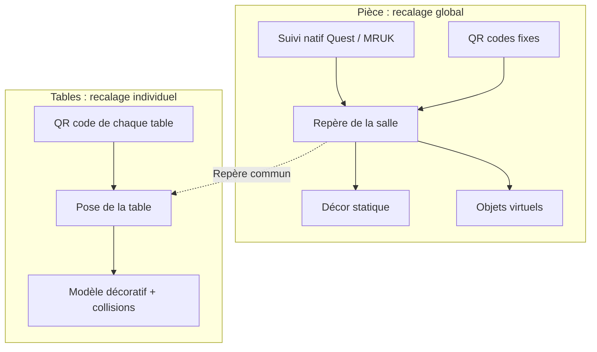
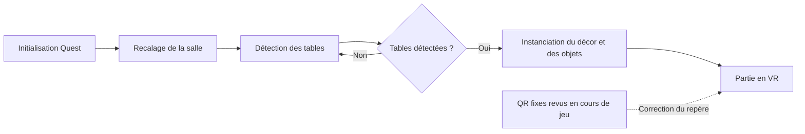

# Architecture

On sépare la scène en **trois catégories d'objets 3D**. Le décor ne doit pas dépendre de la position des tables, et le suivi des tables ne doit pas déplacer la pièce entière.

## Les trois catégories

| Catégorie                       | Contenu                                     | Gestion                                                |
| ------------------------------- | ------------------------------------------- | ------------------------------------------------------ |
| **Environnement statique**      | Murs, sol, plafond, structure de la pièce   | Scan 3D + Blender, recalage global Quest / QR fixes    |
| **Mobilier amovible**           | Tables sur rouesz                            | QR codes propres aux tables, modèles 3D indépendants   |
| **Objets interactifs virtuels** | Indices, mécanismes et autres objets de jeu | Placés dans le repère virtuel, sans QR code individuel |

## 1. Environnement statique

1. Scanner la pièce réelle (première piste : **ScanSpace**, sur appareil compatible).
2. Nettoyer le maillage dans Blender et en retirer les tables mobiles.
3. Garder les bonnes dimensions, puis créer le décor visuel souhaité.
4. Importer dans Unity le **décor visible** et une **géométrie simplifiée** pour les collisions et la navigation.

Le scan sert de base à la géométrie, pas forcément de modèle final : on peut remplacer les matériaux, les murs et les détails, sans changer l'agencement de la salle.

## 2. Mobilier amovible

Les tables sont des objets séparés du scan statique. Chacune possède une identité, des dimensions connues et un ou plusieurs QR codes placés à une position connue sur le meuble.

Au début de chaque partie :

1. Le Quest détecte les QR codes des tables.
2. On récupère leurs positions et orientations **par rapport au repère de la salle**.
3. Unity place le modèle 3D correspondant à chaque table.
4. Son apparence est remplacée par **un objet du décor** : autel, bloc de pierre, bureau, etc.
5. Ses collisions et son obstacle de navigation utilisent la même position.

La disposition peut changer d'une partie à l'autre, **sans liste de configurations prédéfinies**. Pendant une partie du MVP, les tables restent à leur position calibrée : le suivi continu est une [extension](extensions.md).

## 3. Objets interactifs virtuels

Les objets de gameplay existent uniquement dans Unity. Ils peuvent être sélectionnés, déplacés, tournés ou activés selon les interactions retenues. Ils suivent le repère de la scène : **aucun marqueur physique n'est nécessaire pour chacun d'eux**.

Le détail des énigmes reste à décider en équipe, à partir des [propositions](puzzles.md).

## Recalage spatial

On a **deux systèmes indépendants**, qui utilisent le même repère de salle :

- **Pièce :** les outils du Quest donnent une base spatiale ; les QR codes fixes servent à vérifier et corriger l'alignement global au fil de la session.
- **Tables :** chaque QR code fournit la pose de son meuble, sans modifier le recalage global.
- **Objets virtuels :** ils restent placés dans la scène et profitent du recalage global.

Les transformations entre marqueurs, tables et modèle de salle doivent être connues. Le suivi natif et les corrections par QR doivent agir sur un **repère défini**, pour éviter les corrections contradictoires.

## Avant et pendant une partie

Une fois la partie lancée, on ne redétecte pas en continu les tables dans le MVP. Les QR fixes peuvent en revanche servir au recalage global pendant la session.

## Points à tester sur le casque

| Sujet            | Ce qu'on veut vérifier                                            |
| ---------------- | ----------------------------------------------------------------- |
| **Précision**    | Écart entre murs / tables réels et virtuels                       |
| **Stabilité**    | Dérive du repère au fil de la session                             |
| **QR codes**     | Détection, orientation, perte et redétection                      |
| **Mode VR**      | Disponibilité de la détection QR avec notre configuration Meta XR |
| **Performances** | Fluidité du décor et des interactions sur Quest 3                 |
| **Navigation**   | Obstacles des tables correctement transmis au monstre             |

## Outils

| Outil                   | Utilisation                              |
| ----------------------- | ---------------------------------------- |
| **Unity + URP**         | Moteur et rendu VR                       |
| **Meta XR / MRUK**      | Suivi spatial et intégration de la pièce |
| **ScanSpace**           | Première piste pour le scan 3D           |
| **Blender**             | Nettoyage et création du décor           |
| **`tools/markers`**     | Génération des QR codes                  |
| **Unity AI Navigation** | Navigation du monstre dans le MVP 2      |

Voir la [roadmap](roadmap.md) pour l'ordre d'implémentation.
