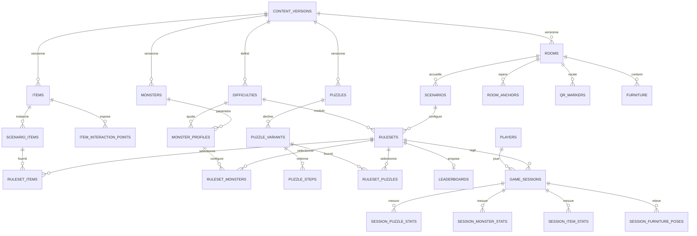

# Schéma relationnel de Tohannic

[schema.sql.bytes](../../Unity/Assets/_Game/Modules/Persistence/Resources/Tohannic/Database/schema.sql.bytes) contient toutes les tables, colonnes, clés, contraintes, index et vues. [seed.sql.bytes](../../Unity/Assets/_Game/Modules/Persistence/Resources/Tohannic/Database/seed.sql.bytes) initialise les types pris en charge et les entrées recensées dans la documentation. L’extension `.bytes` permet d’embarquer le SQL comme ressource Unity.



## Tables et unités

| Domaine | Tables | Données |
| --- | --- | --- |
| Versions | `content_versions`, `published_content_versions`, `active_content_version` | Brouillons, date de publication et version proposée pour les nouvelles parties. |
| Ressources Unity | `asset_refs` | Identifiant de catalogue, clé Unity et type de ressource. Unity résout la clé vers une scène, un prefab, un maillage, un son, un clip ou un contrôleur Animator. |
| Scénarios | `scenarios`, `difficulties`, `rulesets` | Scénario par salle, ancres de départ et de sortie, profils partagés par le scénario et une configuration par difficulté et version. |
| Salle et ambiance | `rooms`, `room_anchors`, `room_decorations`, `room_lights`, `ruleset_room_lights` | Scène, maillages visibles et de collision, son d’ambiance, poses et lumières choisies par configuration. |
| Recalage spatial | `room_calibration_settings`, `furniture`, `qr_markers` | Seuils, dimensions, habillage et collisions, charge utile du QR et transformation locale. Le repère d’un QR est celui du meuble auquel il est lié ou celui de la salle pour un QR fixe. |
| Gestes et physique | `interaction_profiles`, `interaction_feedback_settings`, `physics_profiles` | Seuils de proximité et de confiance, stabilisation, charge et vitesse de lancer, couleurs du feedback et conversion du mouvement en bruit. |
| Définitions et instances d’items | `items`, `item_capability_kinds`, `item_capabilities`, `impact_effect_kinds`, `item_impact_rules`, `item_light_settings`, `scenario_items`, `ruleset_items` | Prefab, masse, seuil de casse, capacités combinables, effets d’impact, lumière des items et placements sélectionnés. `spawn_on_start` distingue les placements présents dès le lancement de ceux activés par une action d’énigme. |
| Points d’interaction | `interaction_kinds`, `item_interaction_points`, `item_free_settings`, `item_rotate_settings`, `item_slide_settings`, `item_press_settings` | Point Unity, portée et une table de paramètres par primitive. Par exemple, `Rotate` stocke son axe et ses limites en degrés. |
| Sélection et progression des énigmes | `puzzles`, `puzzle_variants`, `ruleset_puzzles`, `ruleset_puzzle_prerequisites`, `puzzle_steps`, `puzzle_hints` | Variante choisie par difficulté, prérequis, étapes, indices et énigmes requises pour ouvrir la sortie. La difficulté technique du catalogue est distincte du niveau choisi par le joueur. |
| Conditions d’énigme | `puzzle_step_conditions`, `puzzle_item_event_conditions`, `puzzle_rotation_conditions`, `puzzle_assembly_conditions`, `puzzle_code_conditions`, `puzzle_pull_conditions` | Conditions typées sur des instances du scénario. Toutes les conditions d’une étape doivent être satisfaites. Le code du clavier est du texte pour conserver les zéros initiaux. |
| Actions d’énigme | `puzzle_step_actions`, `puzzle_item_actions`, `puzzle_audio_actions` | Actions exécutées dans l’ordre d’une étape réussie. La proposition de chaîne peut associer un seuil de traction à l’ouverture de la trappe, à l’apparition d’un objet et à un son. |
| Monstre | `monsters`, `monster_profiles`, `monster_navigation_settings`, `monster_ability_kinds`, `monster_profile_abilities`, `ruleset_monsters` | Morphologie et portée de frappe, perception, mémoire, vitesses, récupération, multiplicateurs d’impact, navigation, capacités et apparitions. Un niveau où `allows_monster = 0` ne peut référencer aucun profil de monstre. |
| Animations et sons du monstre | `monster_clips`, `monster_animation_bindings`, `monster_audio_bindings` | Identifiants des clips, associations aux actions, vitesse de lecture, délais de fin et sons. L’Animator porte les événements et les fenêtres d’impact. |
| Classement | `ranked_layouts`, `ranked_layout_furniture`, `leaderboards`, vue `leaderboard_entries` | Classement facultatif par configuration et version. Une disposition de référence est facultative. L’écran applique `display_limit` au rang calculé. |
| Joueurs et parties | `players`, `game_sessions`, vue `player_ruleset_stats` | Pseudonyme, résultat final, durée et admissibilité au classement, nombre de parties, victoires, défaites et meilleur temps. |
| Statistiques détaillées | `session_puzzle_stats`, `session_monster_stats`, `session_item_stats`, `session_furniture_poses`, `session_room_calibrations` | Tentatives et indices, détections et attaques, manipulations, poses mesurées des meubles et mesures de recalage. |

Les positions sont exprimées en mètres, les rotations en quaternions `(x, y, z, w)` et les angles en degrés. Les durées sont en millisecondes, les horodatages en millisecondes Unix UTC. Le jeu calcule la durée avec un chronomètre monotone à partir de `Playing`, après le recalage. La portée physique `attack_range_m` appartient au monstre. Le seuil visuel `attack_distance_m` appartient au profil de difficulté.

## Entrées initiales

`seed.sql.bytes` crée le brouillon `documentation-001` avec les cinq difficultés, les types de capacités et d’interactions, les effets d’impact, le catalogue d’items et d’énigmes candidates, le monstre et ses 21 clips documentés. Les masses, seuils, durées, poses physiques, clés de ressources Unity et sélections d’énigmes sont à renseigner lors du prototypage. Les réglages nécessaires figurent dans les colonnes du schéma. Le brouillon n’est pas publiable comme scénario jouable en l’état.

Sources du catalogue · [Difficultés](../monster/ai/difficulty.md) · [Animations](../monster/animations.md) · [Spécifications des items](../gameplay/items/specifications.md) · [Catalogue des items](../gameplay/items/catalog.md) · [Idées d’énigmes](../gameplay/puzzles.md) · [Proposition de parcours](../report/proposal.tex)

## Publication des configurations (prévue)

1. Préparer une nouvelle version dans un fichier SQLite de configuration. Une définition peut garder son identifiant métier d’une version à l’autre. Les clés composées incluent la version pour que chaque configuration référence ses propres lignes.
2. L’APK importe les lignes de configuration et valide l’ensemble avant publication. SQLite vérifie les types, clés, références et bornes simples. Les validateurs C# vérifient notamment le type des ressources Unity, la normalisation des quaternions, la présence de la table spécialisée attendue, les capacités des items, l’absence de cycles entre énigmes et la disponibilité des placements référencés par la configuration.
3. Enregistrer la publication et changer la version active dans la même transaction. Le code d’import traite chaque version publiée comme immuable et conserve les versions déjà jouées. La partie en cours garde la configuration chargée à son lancement.
4. À la fin d’une partie, écrire la session et ses statistiques dans une transaction. Si un classement exige une disposition de référence, Unity compare les poses mesurées aux tolérances avant d’indiquer l’admissibilité du résultat.

Le classement retient la meilleure victoire admissible de chaque joueur, par version et configuration. Un temps égal est départagé par la date de fin, puis par l’identifiant de partie. `player_ruleset_stats` prend également en compte les défaites et les parties hors classement.

## Ouverture dans Unity

Unity lance l’initialisation de `tohannic.db` dans `Application.persistentDataPath` au démarrage. Le schéma et les entrées initiales sont installés dans une même transaction. Chaque opération ouvre sa connexion avec les clés étrangères activées.

Un module Unity référence l’assemblage `Project.Persistence` et attend `GameDatabase.OpenAsync()` avant d’utiliser [`IGameDatabase`](../../Unity/Assets/_Game/Modules/Persistence/IGameDatabase.cs). L’ouverture charge les ressources sur le thread Unity. Le travail SQLite s’exécute ensuite en arrière-plan et chaque opération rend un `Result<T, DatabaseError>`. Utiliser `TryGetValue` ou `TryGetError` pour traiter le résultat.

Les textes de `DatabaseError.Message` sont définis dans le fichier C# dédié. Les diagnostics de SQLite et du système de fichiers sont disponibles dans `DatabaseError.TechnicalDetails` pour les logs. [DatabaseErrorMessages.cs](../../Unity/Assets/_Game/Modules/Persistence/Infrastructure/DatabaseErrorMessages.cs)

- Les opérations sur les joueurs couvrent la création, la consultation, la liste et le changement de pseudonyme.
- `ReadLeaderboardAsync` filtre les scores par version et ruleset. `ReadPlayerStatsAsync` lit les statistiques agrégées du joueur.
- `SaveSessionAsync` enregistre une partie terminée avec ses mesures dans une seule transaction. `ReadSessionsAsync` charge l’historique et `ReadSessionAsync` restitue le détail.
- `ReadActiveCatalogAsync` et `ReadCatalogAsync` lisent un instantané de la configuration et des tables spécialisées. Le premier requiert une version publiée et active. Le second accepte aussi le brouillon initial.

## Ouvrir une base de travail

Depuis la racine du dépôt, utiliser un nouveau fichier SQLite.

```bash
database_scripts=Unity/Assets/_Game/Modules/Persistence/Resources/Tohannic/Database
sqlite3 -bail tohannic-schema.db \
    'PRAGMA foreign_keys = ON;' 'BEGIN IMMEDIATE;' \
    ".read $database_scripts/schema.sql.bytes" ".read $database_scripts/seed.sql.bytes" \
    'COMMIT;'
sqlite3 -bail tohannic-schema.db 'PRAGMA foreign_key_check;' 'PRAGMA integrity_check;'
```
