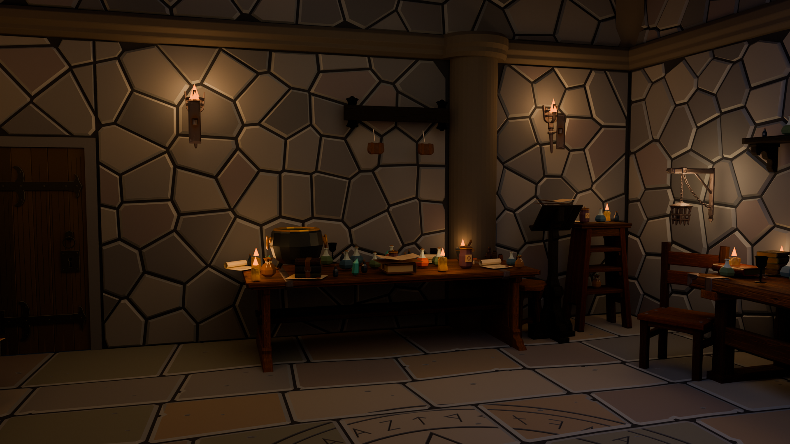

# Environnement virtuel

## Présentation

Le MVP de **Tohannic: No Way Out** se déroule dans une salle virtuelle alignée sur une pièce réelle. Le décor change son apparence tout en conservant l'échelle, les ouvertures et les obstacles physiques.

La salle a été modélisée dans Blender ; son intégration et sa validation dans Unity et sur Meta Quest 3 restent à vérifier.

## Direction artistique

Le thème retenu est **une salle d'alchimie médiévale fantasy low-poly**. Murs de pierre, voûte gothique, nervures, piliers, entablements et sol gravé forment une architecture stylisée. Mobilier en bois et pierre, équipements d'alchimie et accessoires créent une ambiance dense, sombre et mystérieuse sans nuire à la lisibilité. Le rendu reste stylisé et devra être validé sur le casque VR autonome.

## Aperçu de l'environnement 3D

Les captures ci-dessous montrent la présentation Blender actuelle.

### Vue générale

### Architecture et plafond

### Point de vue du joueur

### Espace d'alchimie

## Composition

| Famille                                   | Rôle dans la salle                                                                                          |
| ----------------------------------------- | ----------------------------------------------------------------------------------------------------------- |
| Architecture statique et décor structurel | Murs, sol, voûte, piliers, portes, entablements et motif gravé.                                             |
| Mobilier fixe et rangement                | Tables de décor, établi, bibliothèques, étagères, sièges et contenants.                                     |
| Mobilier amovible                         | Tables physiques repositionnables, représentées par des modèles virtuels séparés du décor statique.         |
| Éclairage                                 | Ambiance de la salle et luminaires fixes.                                                                   |
| Items purement virtuels                   | Objets de gameplay, documents et accessoires ; leurs capacités restent indépendantes de leur modèle visuel. |

Voir le [catalogue des assets](assets.md), le [catalogue des items](../gameplay/items/catalog.md) et leur [règle de classement](../gameplay/items/README.md). Le recalage de la salle, le placement initial des tables et la cohérence des collisions sont détaillés dans l'[architecture](../architecture.md). Dans le MVP, les tables restent fixes pendant la partie ; leur suivi continu est une [extension](../extensions.md).

## Documentation associée

- [Catalogue des assets d'environnement](assets.md)
- [Architecture et recalage](../architecture.md)
- [Catalogue des items](../gameplay/items/catalog.md)
- [Roadmap](../roadmap.md)
- [Extensions](../extensions.md)
