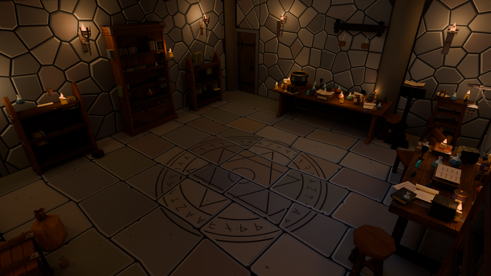
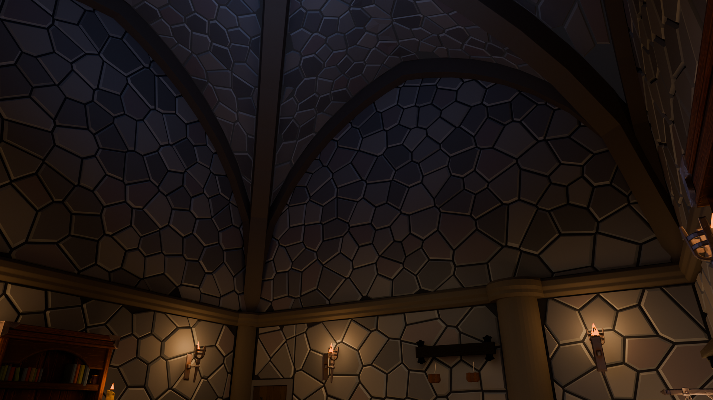
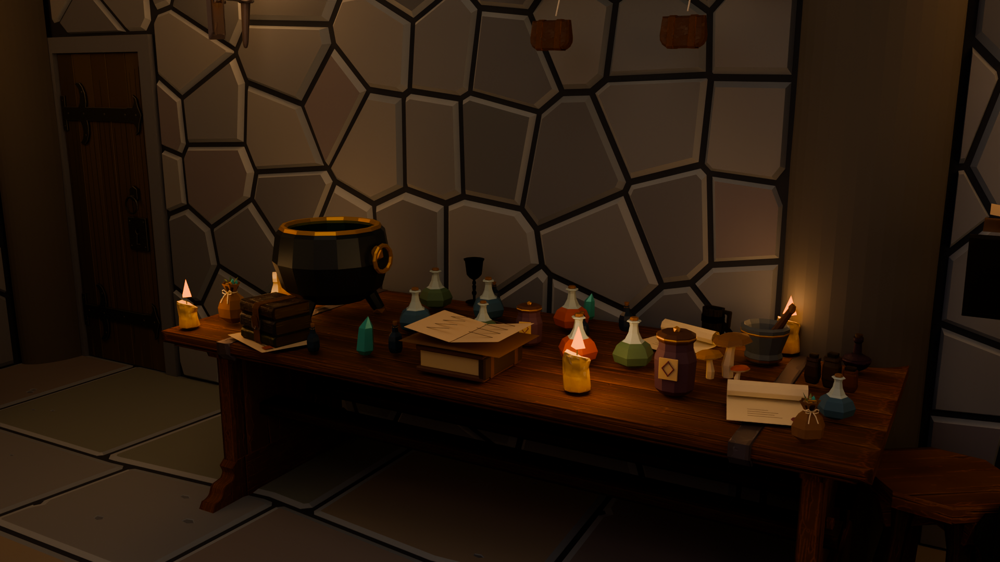

# Environnement virtuel

## Présentation

Le MVP de **Tohannic: No Way Out** se déroule dans une seule salle virtuelle, construite pour un escape game en VR et alignée sur une pièce réelle. La géométrie physique, l'échelle, les ouvertures et les obstacles doivent rester cohérents avec leur représentation virtuelle ; le décor change l'apparence de la salle sans changer son repère spatial.

La salle et sa présentation ont déjà été modélisées dans Blender. Leur intégration, leurs collisions, leur rendu et leurs performances dans Unity puis sur Meta Quest 3 restent des étapes distinctes à vérifier.

## Direction artistique

Le thème retenu est **une salle d'alchimie médiévale fantasy low-poly**. Murs de pierre, voûte gothique, nervures, piliers, entablements et sol gravé forment une architecture stylisée. Mobilier médiéval en bois et pierre, équipements d'alchimie et accessoires composent un décor dense, sombre et mystérieux, tout en gardant la pièce lisible. Géométrie et matériaux restent simples et cohérents ; le photoréalisme n'est pas l'objectif. Les choix de rendu devront être validés sur le casque VR autonome.

## Aperçu de l'environnement 3D

Les captures ci-dessous montrent la présentation Blender actuelle.

### Vue générale

### Architecture et plafond

### Point de vue du joueur

### Espace d'alchimie

## Composition

| Famille                                   | Rôle dans la salle                                                                                          |
| ----------------------------------------- | ----------------------------------------------------------------------------------------------------------- |
| Architecture statique et décor structurel | Murs, sol, voûte, piliers, portes, entablements et motif gravé.                                             |
| Mobilier fixe et rangement                | Tables de décor, établi, bibliothèques, étagères, sièges et contenants.                                     |
| Mobilier amovible                         | Tables physiques repositionnables, représentées par des modèles virtuels séparés du décor statique.         |
| Éclairage                                 | Ambiance de la salle et luminaires fixes.                                                                   |
| Items purement virtuels                   | Objets de gameplay, documents et accessoires ; leurs capacités restent indépendantes de leur modèle visuel. |

Le [catalogue des assets](assets.md) recense les ressources d'environnement ; le [catalogue des items](../gameplay/items/catalog.md) recense les objets susceptibles de participer au gameplay. Un modèle 3D d'item reste techniquement un asset Unity/Blender : cette séparation sert uniquement à organiser la documentation.

## Alignement spatial

Le décor statique suit le recalage global de la salle, fondé sur le suivi spatial du Quest et des QR codes fixes. Chaque table physique possède ses propres QR codes pour son identification et son placement initial. Dans le MVP, les tables sont calibrées avant chaque partie et gardent ensuite cette position ; le suivi continu est une extension. Le décor statique et les modèles de tables restent séparés, et géométrie visible, collisions et obstacles de navigation doivent rester cohérents.

Les transformations de repères et le déroulement du recalage sont décrits dans l'[architecture](../architecture.md).

## Production et intégration

| Outil        | Responsabilité                                                      | État                                                                  |
| ------------ | ------------------------------------------------------------------- | --------------------------------------------------------------------- |
| Blender      | Modélisation de la salle et préparation des modèles 3D.             | Scène de présentation existante ; préparation pour le jeu à vérifier. |
| Unity        | Intégration de la scène, matériaux, éclairage, collisions et rendu. | Intégration de cette scène à vérifier.                                |
| Meta Quest 3 | Exécution VR, suivi spatial et validation en situation.             | Validation de cette scène sur casque à vérifier.                      |

## Documentation associée

- [Catalogue des assets d'environnement](assets.md)
- [Architecture et recalage](../architecture.md)
- [Catalogue des items](../gameplay/items/catalog.md)
- [Roadmap](../roadmap.md)
- [Extensions](../extensions.md)
