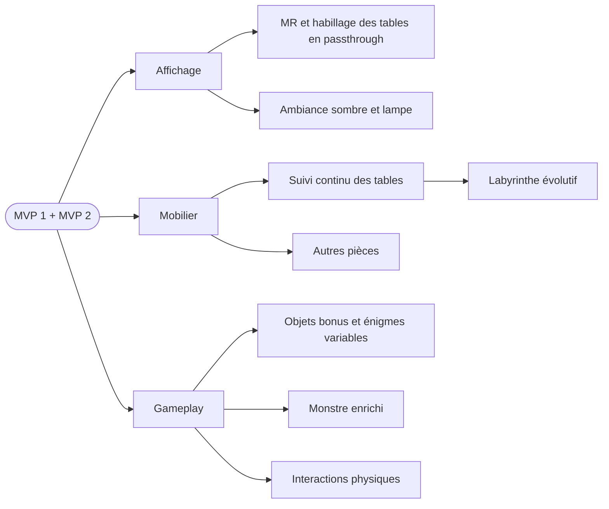

# Extensions

Des idées pour aller plus loin **après les MVP**, sans en faire des obligations maintenant.

___

## Affichage et immersion

### Réalité mixte (MR)

Passer du décor VR à la vraie salle en passthrough, avec les indices, le monstre et des éléments virtuels ajoutés.

On pourrait aussi **recouvrir visuellement les tables détectées par QR code** pour leur donner une autre apparence en MR. C'est distinct de leur habillage en VR, qui est déjà obligatoire : en MR, il faut gérer la présence de l'image réelle de la table et les occlusions.

**Difficulté :** moyenne à élevée suivant le rendu recherché.

### Ambiance sombre et lampe

Créer un décor plus sombre, éventuellement avec une lampe virtuelle disponible dès le départ ou à retrouver dans le jeu.

**Difficulté :** faible à moyenne suivant les effets.

___

## Mobilier et environnement

### Suivi continu des tables

Au lieu de les calibrer seulement avant la partie, mettre à jour leurs positions **pendant le jeu** et synchroniser le décor, les collisions et les obstacles du monstre.

La détection QR native n'est pas conçue pour garantir un suivi stable à 10 ou 30 Hz : il faudra mesurer ses performances avant de choisir cette solution.

**Difficulté :** élevée, extension expérimentale.

### Labyrinthe évolutif

Modifier physiquement les passages en déplaçant les tables **pendant une partie**. La scène et la navigation s'adapteraient à ces déplacements.

Une disposition différente **entre deux parties est déjà prise en charge par le MVP** : seule l'évolution en cours de jeu constitue une extension.

**Difficulté :** élevée, dépend du suivi continu.

### Couloir et autres pièces

Étendre l'expérience à plusieurs zones, avec recalage entre les pièces, décor supplémentaire et navigation adaptée.

**Difficulté :** moyenne à élevée.

___

## Gameplay

### Objets virtuels supplémentaires

Ajouter des objets avec des effets sur le jeu ou le monstre : attirer son attention, le ralentir, déclencher un événement, débloquer une étape, etc.

**Difficulté :** variable.

### Énigmes et indices variables

Prévoir plusieurs énigmes ou changer certains emplacements d'indices entre les parties. Ce n'est pas de la génération procédurale obligatoire : les énigmes de base restent à définir avec l'équipe.

**Difficulté :** moyenne.

### Monstre plus évolué

Affiner sa recherche après perte de vue, ajouter des réactions aux objets, enrichir les transitions ou utiliser des déformations visuelles ponctuelles (*blend shapes*). Le catalogue de [monster_animations.md](monster_animations.md) reste la référence.

**Difficulté :** moyenne à élevée.

### Interactions avec des objets physiques

Permettre un jour de manipuler un vrai objet ou d'utiliser directement un élément de la pièce, en plus des interactions virtuelles.

**Difficulté :** élevée ; non retenu actuellement.

___

## Vue d'ensemble

## Comparatif rapide

| Extension                                            | Difficulté estimée |
| ---------------------------------------------------- | ------------------ |
| Ambiance sombre / lampe                              | Faible à moyenne   |
| Objets virtuels supplémentaires                      | Variable           |
| Réalité mixte et habillage des tables en passthrough | Moyenne à élevée   |
| Énigmes / indices variables                          | Moyenne            |
| Comportements supplémentaires du monstre             | Moyenne à élevée   |
| Suivi continu des tables                             | Élevée             |
| Labyrinthe évolutif pendant une partie               | Élevée             |
| Couloir ou nouvelles pièces                          | Moyenne à élevée   |
| Interactions avec des objets physiques               | Élevée             |

Ces idées restent à choisir en équipe en fonction du temps et des résultats sur le Quest 3.
