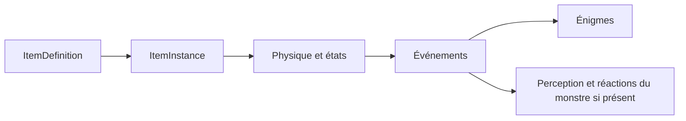

# Items

Un **item** est un type d'objet susceptible de servir au gameplay, aux énigmes ou aux interactions physiques avec la salle. Son classement ne décide pas s'il est saisissable, transportable, lançable, cassable ou activable. Sa définition réutilisable est distincte de l'état de chaque `ItemInstance` créée dans Unity. Les modèles 3D des items sont techniquement des assets Unity/Blender, mais le [catalogue des assets d'environnement](../../environment/assets.md) ne les duplique pas.

Le système doit fonctionner sans monstre en difficulté `Peaceful`. Les items peuvent transmettre des événements aux énigmes, à la perception et aux réactions du monstre, sans modifier directement l'état de l'IA.

## Organisation proposée

| Élément          | Responsabilité                                                                |
| ---------------- | ----------------------------------------------------------------------------- |
| `ItemDefinition` | Définition réutilisable : identifiant, capacités et propriétés configurables. |
| `ItemInstance`   | Occurrence en scène et état courant.                                          |
| Capacités        | Propriétés combinables, indépendantes du type concret d'objet.                |
| Physique         | Masse, vélocité, collisions, bruit et casse lorsque pertinents.               |
| Événements       | Transmission aux énigmes et aux autres systèmes intéressés.                   |

Des `ScriptableObject` pour les définitions et des composants Unity pour les instances constituent une proposition technique, non une obligation d'implémentation. Les modalités de manipulation des items par le joueur seront documentées ultérieurement.

## Documentation

- [Catalogue des items](catalog.md)
- [Spécifications communes](specifications.md)
- [Interactions physiques avec l'environnement](environment_interactions.md)
- [Réactions du monstre](../../monster/ai/item_reactions.md)
- [Propositions d'énigmes](../puzzles.md)
- [Catalogue des assets d'environnement](../../environment/assets.md)
