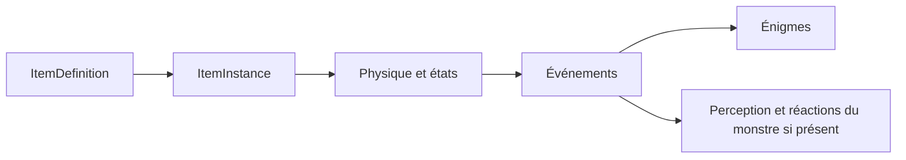

# Items

Un **item** est un objet susceptible de servir au gameplay ou aux énigmes, quelle que soit sa taille. Les [assets d'environnement](../../environment/assets.md) décrivent l'architecture, le mobilier et le décor fixe. Un modèle d'item est aussi un asset au sens de Unity/Blender, mais il ne figure que dans le [catalogue des items](catalog.md). Ce classement ne fixe pas ses capacités de manipulation.

Le système fonctionne aussi en mode `Peaceful`, sans monstre. Il transmet des événements aux énigmes et, si le monstre existe, à ses modules de perception et de réaction, sans dépendre de l'IA.

## Organisation proposée

| Élément          | Responsabilité                                                   |
| ---------------- | ---------------------------------------------------------------- |
| `ItemDefinition` | Définition réutilisable : capacités et propriétés configurables. |
| `ItemInstance`   | Référence à sa définition et état courant.                       |

Des `ScriptableObject` et composants Unity sont une proposition technique. Les [capacités](specifications.md), les [collisions et événements](environment_interactions.md) et les [interactions joueur/items](player_interactions.md) ont des responsabilités distinctes.

## Documentation

- [Catalogue des items](catalog.md)
- [Spécifications communes](specifications.md)
- [Interactions physiques avec l'environnement](environment_interactions.md)
- [Interactions joueur/items](player_interactions.md)
- [Réactions du monstre](../../monster/ai/item_reactions.md)
- [Propositions d'énigmes](../puzzles.md)
- [Catalogue des assets d'environnement](../../environment/assets.md)
