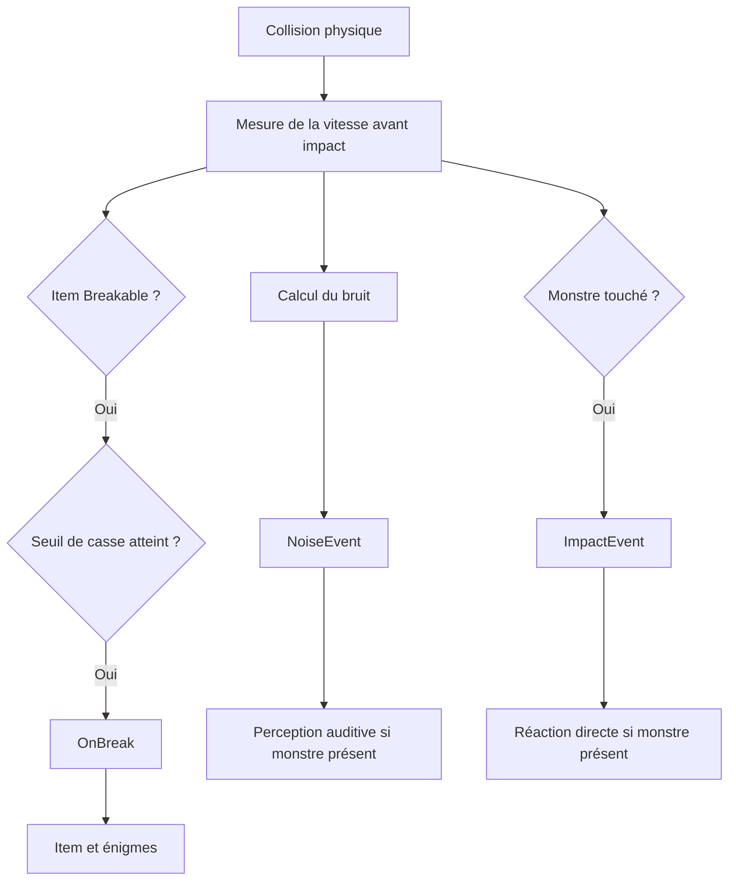

# Interactions physiques des items avec l'environnement

Les modalités de sélection, de prise, de relâchement, de lancer et d'activation par le joueur seront documentées ultérieurement. Les contrats physiques ci-dessous valent quelle que soit l'origine du mouvement d'un item et fonctionnent aussi en mode `Peaceful`.

## Collisions, impacts et bruit

Toute nouvelle collision physique significative peut déclencher `OnImpact`, que l'item soit tombé, ait été déplacé ou ait rebondi. La vélocité est relevée juste avant chaque collision. Les notifications multiples d'une même collision ne produisent qu'un traitement ; un contact permanent n'émet pas de bruit à chaque mise à jour physique. Des rebonds distincts peuvent produire des bruits distincts.

```text
impactSpeed = length(preImpactVelocity)
noiseIntensity = k * impactSpeed
impactStrength = mass * impactSpeed
```

`k` est un éventuel coefficient global de conversion en intensité de jeu, à définir. Le bruit dépend uniquement de la vitesse avant impact : la masse ne modifie pas `noiseIntensity`. Elle intervient dans `impactStrength` (kg·m/s), quantité de mouvement simplifiée utilisée pour apprécier la sévérité d'un impact direct, **pas une force en newtons**. Une collision peut produire un bruit sans lancer préalable. Les seuils et portées auditifs appartiennent au [profil du monstre](../../monster/ai/difficulty.md), et aucune simulation acoustique complexe n'est prévue au MVP.

Le bruit, l'effet direct sur le monstre lorsqu'il est effectivement touché et la casse sont évalués indépendamment. Un impact trop faible pour un effet direct peut tout de même être audible ou casser l'item.

## Casse

La règle proposée est `canBreak = hasBreakableCapability AND impactSpeed >= breakThreshold`. Le seuil de vitesse est configurable et indépendant des seuils auditifs et des règles d'impact direct. Une collision qui casse l'item produit un seul `NoiseEvent` de collision ; un son de casse distinct peut être joué. La simulation physique de fragments n'est pas imposée.

## Contrats d'événements

| Événement | Données utiles | Destinataire |
| --- | --- | --- |
| `OnImpact` | Instance, point, cible, vitesse avant impact, masse ou définition, sévérité calculée. | Logique physique de l'item. |
| `NoiseEvent` | Vraie position de la source, intensité, type de stimulus, origine et cible touchée si pertinente. | Perception auditive. |
| `ImpactEvent` | Item, cible effectivement touchée, vitesse et sévérité de l'impact. | Réactions aux impacts directs. |
| `OnBreak` | Instance cassée. | Item et énigmes. |

`OnGrab`, `OnRelease`, `OnThrow` et `OnActivate` restent des noms d'événements proposés pour une conception ultérieure de la manipulation ; leur déclenchement et leur implémentation ne sont pas définis ici.

Un impact direct sur le monstre peut produire `NoiseEvent` et `ImpactEvent`, mais son effet direct n'est appliqué qu'une fois. La [perception auditive](../../monster/ai/perception.md) filtre les bruits produits par le monstre et ceux des collisions qui le touchent, sans supprimer le son entendu par le joueur. Le capteur peut utiliser la vraie position de la source pour ses tests ; la mémoire et la FSM ne reçoivent que des observations limitées, sans position réelle automatiquement révélée. Ces échanges ne rendent pas la physique des items dépendante de la présence du monstre.



Les valeurs et les règles propres à chaque objet restent à définir. Voir les [spécifications](specifications.md), le [catalogue](catalog.md) et les [réactions du monstre](../../monster/ai/item_reactions.md).

Les fichiers audio d'impact et de casse destinés au joueur restent à définir ; un `NoiseEvent` de gameplay ne constitue pas à lui seul une ressource sonore.
