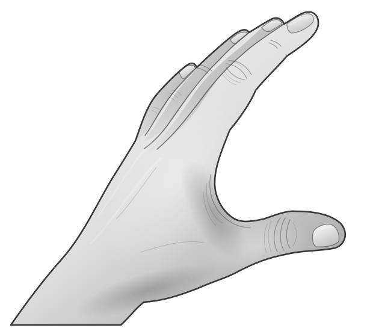
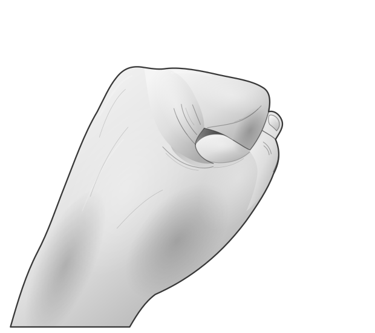
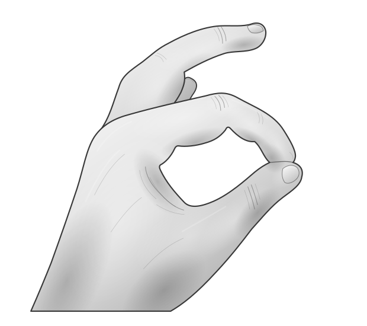
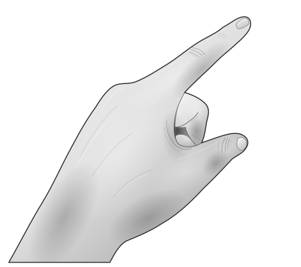
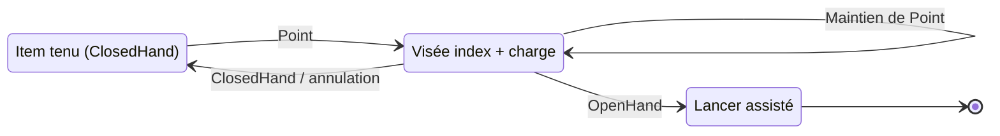
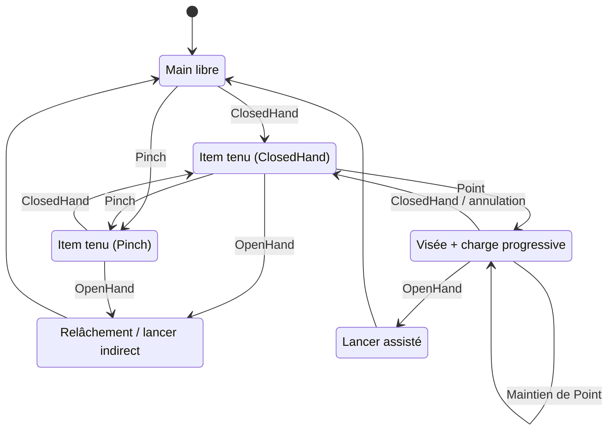
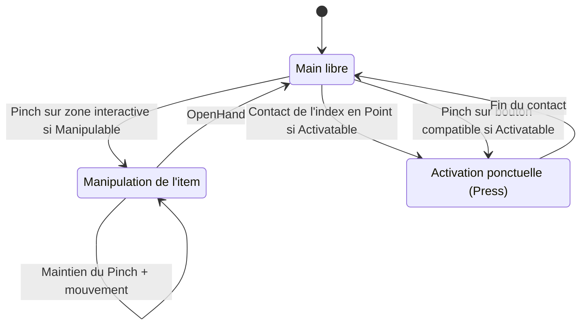
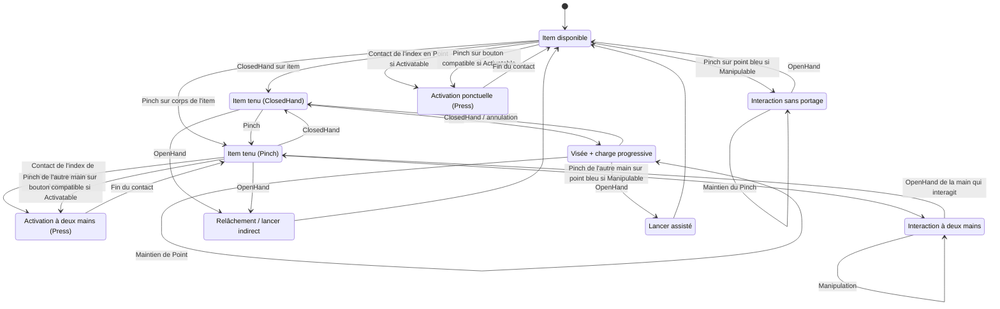
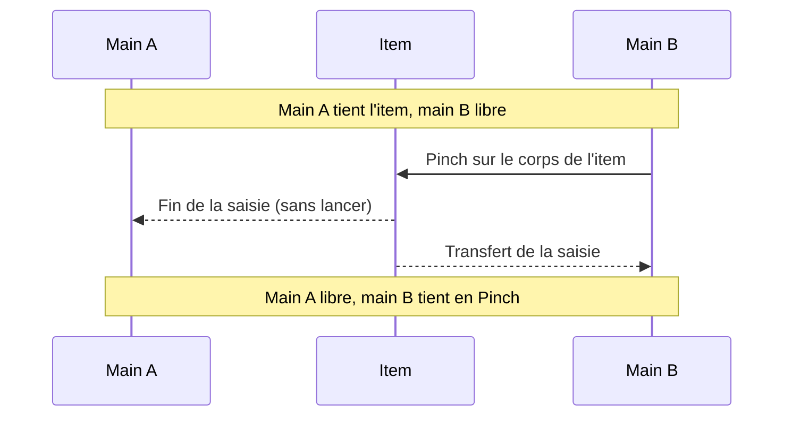

# Player → Item Interactions

## 1. Hand Tracking

Le joueur manipule les items virtuels avec ses mains, sans manettes ni ciblage par le regard. Le ciblage repose sur la proximité de la main avec l'item ou l'un de ses points d'interaction.

Chaque main dispose de sa propre position, orientation et vélocité. Les deux mains sont gérées indépendamment, sans distinction entre main dominante et secondaire.

|                               `OpenHand`                                |                               `ClosedHand`                               |                             `Pinch`                              |                              `Point`                               |
| :---------------------------------------------------------------------: | :----------------------------------------------------------------------: | :--------------------------------------------------------------: | :----------------------------------------------------------------: |
|  |  |  |  |
|                               Relâchement                               |                              Saisie globale                              |                   Saisie précise / interaction                   |       Visée et charge du lancer assisté / appui avec l'index       |

L'action associée à un geste dépend de l'état de la main et des capacités de l'item. Les seuils de reconnaissance, de proximité et de transition seront définis pendant l'implémentation et les tests.

## 2. Catégories d'items et feedback visuel

Un glow autour de l'item indique les interactions disponibles. Sa couleur découle des [capacités statiques](specifications.md#1-types-et-capacités) :

| Glow   | Capacités                                          | Interactions possibles                                                             | Exemples                             |
| ------ | -------------------------------------------------- | ---------------------------------------------------------------------------------- | ------------------------------------ |
| Rouge  | `Grabbable` sans `Manipulable` ni `Activatable`    | Saisir, déplacer, relâcher, lancer.                                                | Caillou, bouteille simple.           |
| Violet | `Grabbable` avec `Manipulable` et/ou `Activatable` | Gestes de saisie et de lancer, plus manipulation et/ou activation selon les flags. | Fiole avec bouchon, boîte, grimoire. |
| Bleu   | `Manipulable` et/ou `Activatable` sans `Grabbable` | Manipuler et/ou activer sans déplacer librement l'item.                            | Levier, vanne, bouton.               |
| Aucun  | Aucune de ces trois capacités                      | Aucune interaction joueur correspondante.                                          | —                                    |

`Breakable` n'influe pas sur la couleur. Ces catégories n'imposent pas de types distincts dans le code ; les exemples n'attribuent pas automatiquement de capacités aux items cités.

### Points d'interaction

Lorsqu'une manipulation ou activation spécifique vise un emplacement précis, un **point de glow bleu** indique cette zone, en complément du glow global de l'item.

- Levier bleu : point bleu sur la poignée.
- Vanne bleue : point bleu sur la zone de manipulation.
- Boîte violette : point bleu sur le couvercle ou le mécanisme manipulable.
- Fiole violette : point bleu sur le bouchon.
- Bouton bleu : point bleu sur la surface à presser avec l'index.

Un `Pinch` sur le corps d'un item `Grabbable` permet de le déplacer. Si l'item est `Manipulable`, un `Pinch` sur un point d'interaction manipule la partie associée sans saisir l'item entier. Si l'item est `Activatable`, un contact de l'index en `Point` déclenche une activation `Press` compatible ; le `Pinch` peut également déclencher `Press` si l'item le prévoit. Sans point spécifique, le geste s'effectue sur la zone interactive de l'item. Pointer à distance ne déclenche pas l'interaction.

## 3. Saisie, déplacement et lancer

Ces gestes concernent les items `Grabbable` ; le lancer ne demande aucune capacité distincte.

### 3.1. Modes de saisie

| Geste        | Fonction                                                     |
| ------------ | ------------------------------------------------------------ |
| `ClosedHand` | Saisie globale, principalement destinée au lancer.           |
| `Pinch`      | Saisie précise, déplacement, orientation et lancer indirect. |

L'item suit les mouvements de la main qui le tient. Son repère relatif à la main est conservé pendant la manipulation.

Les transitions `Pinch → ClosedHand` et `ClosedHand → Pinch` permettent de changer de mode de saisie sans relâcher l'item. Sa position et son orientation doivent rester continues pendant la transition.

### 3.2. Lancer indirect (naturel)

Depuis une saisie en `ClosedHand` ou en `Pinch`, le passage en `OpenHand` relâche l'item avec la vélocité issue du mouvement de la main.

Un mouvement lent permet de déposer l'item ; un mouvement rapide permet de le lancer naturellement. Aucun geste supplémentaire n'est nécessaire.

### 3.3. Lancer direct (assisté)

Le passage de `ClosedHand` à `Point` active le mode de lancer assisté. L'item reste associé à la main pendant la préparation du lancer.

| Geste / transition   | Action                                                                 |
| -------------------- | ---------------------------------------------------------------------- |
| `ClosedHand → Point` | Commencer la charge et la visée.                                       |
| Maintien de `Point`  | Remplir progressivement la jauge et ajuster la direction avec l'index. |
| `Point → OpenHand`   | Lancer l'item selon la puissance accumulée et la direction visée.      |
| `Point → ClosedHand` | Annuler la charge et revenir à la saisie.                              |

La jauge indique la puissance accumulée. Elle est réinitialisée au début de chaque préparation et lors de son annulation.



La direction est obtenue à partir de l'orientation de l'index. La dernière direction valide pendant `Point` est conservée pour éviter que l'ouverture de la main ne modifie la trajectoire au moment du lancer.

```text
direction = normalize(indexTip - indexProximal)
power = clamp(chargeTime / maxChargeTime, 0, 1)
throwVelocity = direction * power * maxThrowSpeed
```

La durée de charge, la vitesse maximale et les paramètres de stabilisation seront déterminés pendant l'implémentation et les tests.

## 4. Items saisissables et lançables — Rouge

L'item peut être saisi en `ClosedHand` ou en `Pinch`. Les deux modes de saisie autorisent le lancer indirect ; le lancer assisté nécessite de passer par `ClosedHand`.



Le changement de main est également possible par `Pinch` (voir section 7).

## 5. Items sans saisie libre — Bleu

Un item bleu `Manipulable`, comme un levier ou une vanne, est manipulé en `Pinch` sur sa zone interactive selon la primitive associée. Un item bleu `Activatable`, comme un bouton, reçoit une activation ponctuelle en `Point` par contact de l'index. Les deux capacités peuvent coexister.

L'ouverture de la main termine une manipulation en `Pinch`. L'item reste soumis à ses contraintes : il ne peut pas être saisi librement ni lancé.



### Primitives de manipulation

Les primitives sont réutilisables par les items fixes et les points d'interaction des items transportables.

| Primitive | Fonction                                                                            | Exemple                           |
| --------- | ----------------------------------------------------------------------------------- | --------------------------------- |
| `Free`    | Translation et rotation libres de la partie manipulée, selon les limites de l'item. | Bouchon détachable                |
| `Rotate`  | Rotation autour d'un axe ou d'un pivot.                                             | Vanne, levier, couvercle articulé |
| `Slide`   | Translation le long d'un axe.                                                       | Tiroir                            |
| `Press`   | Activation ponctuelle en `Point` ; aussi en `Pinch` si prévue pour l'item.          | Bouton                            |

Les contraintes, limites de mouvement et effets de chaque primitive sont propres à l'item. Pour `Press`, un contact continu ne déclenche pas plusieurs activations : le joueur doit interrompre le contact avant de pouvoir appuyer de nouveau. Le geste `Point` déclenche une interaction `Press` uniquement si la main est libre d'interagir, et jamais pendant la visée d'un lancer assisté.

## 6. Items transportables et interactifs — Violet

Ces items combinent `Grabbable` avec `Manipulable`, `Activatable` ou les deux.

Ils peuvent être saisis en `ClosedHand` ou en `Pinch`, déplacés, relâchés ou lancés. Les manipulations continues en `Pinch` exigent `Manipulable` ; les activations ponctuelles en `Point` exigent `Activatable`.



Le graphe représente le comportement de l'item ; les états des mains restent indépendants. L'interaction à deux mains est représentée avec un maintien en `Pinch`, mode privilégié pour ce type de manipulation.

### Interaction à deux mains

Une main maintient et oriente l'item ; la seconde manipule un point bleu en `Pinch` si l'item est `Manipulable`, ou active un bouton compatible avec `Press` en `Point` (ou en `Pinch` si prévu) s'il est `Activatable`. Les rôles sont interchangeables.

Exemple : une main tient une fiole, l'autre retire le bouchon. La fiole peut ensuite être orientée pour verser son contenu si cette mécanique est implémentée.

Le débouchage, le versement et le mélange de liquides constituent des exemples d'interactions spécifiques à une énigme d'alchimie. Ils ne sont pas détaillés ici.

## 7. Gestion des deux mains

### 7.1. Transfert d'un item

Lorsqu'une main tient un item rouge ou violet et que l'autre est libre, le joueur peut transférer l'item à cette dernière par `Pinch`.

Le pinch de la main réceptrice doit cibler le corps de l'item et non un point d'interaction bleu. L'item change de main sans chute ni lancer et conserve sa position et son orientation. La main d'origine devient libre ; la main réceptrice tient désormais l'item en `Pinch`.



Le transfert fonctionne dans les deux sens et n'est pas effectué pendant une manipulation à deux mains ou la préparation d'un lancer assisté.

### 7.2. Interaction et transfert

| Geste et cible de la main libre               | Action                                                         |
| --------------------------------------------- | -------------------------------------------------------------- |
| `Pinch` sur le corps d'un item déjà tenu      | Transférer l'item.                                             |
| `Pinch` sur un point bleu d'un item déjà tenu | Manipuler à deux mains si `Manipulable`, sans transfert.       |
| `Point` avec contact sur un bouton compatible | Activer si `Activatable`, sans transfert.                      |
| `Pinch` sur un bouton compatible              | Activer si `Activatable` et prévu pour l'item, sans transfert. |

### 7.3. États logiques des mains

Chaque main dispose d'une FSM indépendante. Les deux FSM partagent les informations sur les items et points d'interaction déjà occupés.

| État            | Description                                                                           |
| --------------- | ------------------------------------------------------------------------------------- |
| `Free`          | Aucun item tenu ni interaction active.                                                |
| `HoldingClosed` | Item saisi en `ClosedHand`.                                                           |
| `HoldingPinch`  | Item saisi en `Pinch`.                                                                |
| `Manipulating`  | Manipulation d'un point ou d'une zone interactive en `Pinch`.                         |
| `Pressing`      | Activation ponctuelle en `Point`, ou en `Pinch` si prévue, jusqu'à la fin du contact. |
| `Aiming`        | Visée et charge du lancer assisté en `Point`.                                         |

Les changements de gestes doivent être stabilisés pour éviter les relâchements involontaires lors de transitions intermédiaires.

## 8. Récapitulatif des interactions

| Interaction                                    | Rouge |               Violet                |                Bleu                 |
| ---------------------------------------------- | :---: | :---------------------------------: | :---------------------------------: |
| Saisie en `ClosedHand` ou `Pinch`              |  Oui  |                 Oui                 |                 Non                 |
| Changement de mode et déplacement libre        |  Oui  |                 Oui                 |                 Non                 |
| Lancer indirect ou assisté                     |  Oui  |                 Oui                 |                 Non                 |
| Manipulation spécifique en `Pinch`             |  Non  |          Si `Manipulable`           |          Si `Manipulable`           |
| Activation `Press` en `Point`                  |  Non  |          Si `Activatable`           |          Si `Activatable`           |
| Activation `Press` en `Pinch`                  |  Non  | Si prévue pour l'item `Activatable` | Si prévue pour l'item `Activatable` |
| Manipulation à deux mains (maintien + `Pinch`) |  Non  |          Si `Manipulable`           |                 Non                 |
| Transfert entre mains                          |  Oui  |                 Oui                 |                 Non                 |

## 9. Physique et IA du monstre

Les lancers direct et indirect produisent une vélocité initiale, puis utilisent les mêmes règles physiques. La vélocité au moment de la collision détermine l'intensité du bruit généré.

Le système d'interaction fournit la vélocité de l'item. La gestion des collisions, des impacts et des stimuli sonores relève du système physique et de l'IA du monstre.

## 10. Implémentation et tests

Les seuils et valeurs numériques ne sont pas fixés dans cette documentation. Ils seront déterminés pendant l'implémentation et les tests, notamment sur Quest 3.

- [ ] Tester la reconnaissance des quatre gestes et la stabilité de leurs transitions.
- [ ] Déterminer les seuils de proximité et les règles de priorité entre corps et points d'interaction.
- [ ] Régler la charge, la direction et la vélocité des lancers.
- [ ] Régler l'affichage du glow global et des points bleus.
- [ ] Valider les transferts et les manipulations à deux mains.
- [ ] Tester les appuis en `Point` (contact, réarmement et distinction avec le lancer assisté).
- [ ] Définir le comportement lorsqu'une main perd son suivi ou que la main porteuse relâche l'item pendant une interaction à deux mains.

Les noms des états, des primitives et des capacités constituent des conventions de documentation et pourront être adaptés à l'implémentation.
