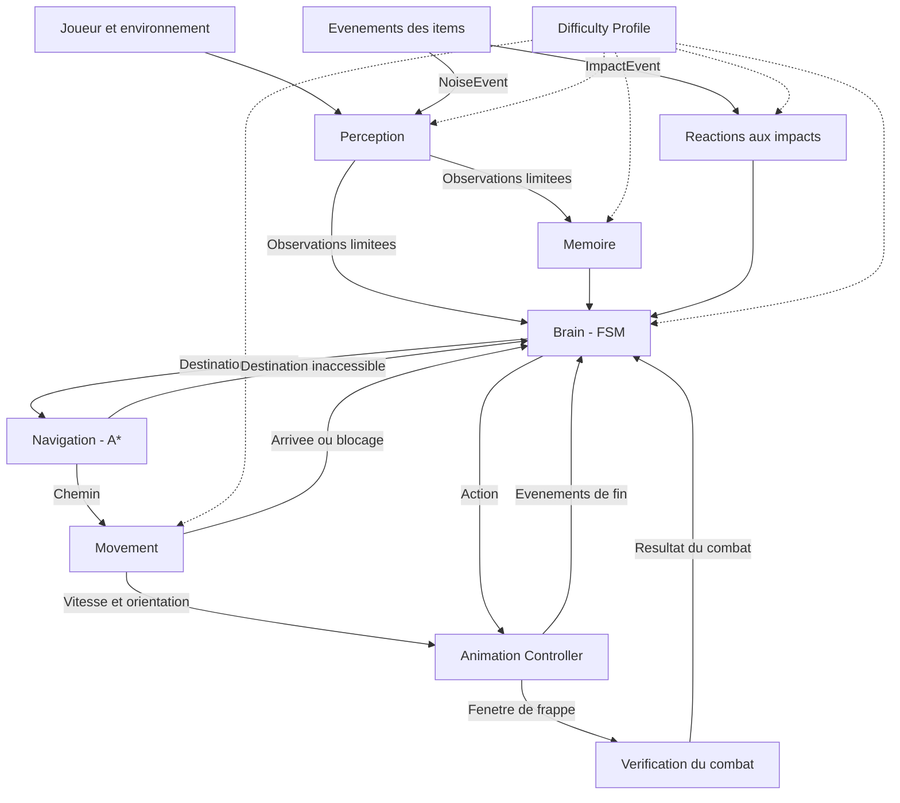

# Architecture de l'IA du monstre

## 1. Type d'agent

| Caractéristique   | Choix                                                                                         |
| ----------------- | --------------------------------------------------------------------------------------------- |
| Agent             | Agent à états internes, avec mémoire limitée.                                                 |
| Prise de décision | FSM classique (Finite State Machine), non hiérarchique.                                       |
| Observabilité     | Partielle : informations perceptives limitées.                                                |
| Environnement     | Dynamique (joueur et items mobiles) ; géométrie de navigation fixe pendant une partie du MVP. |
| Perception        | Vision conique et audition.                                                                   |
| Mémoire           | Pistes approximatives et temporaires.                                                         |
| Navigation        | NavMesh généré par Unity au début de partie + algo A*.                                        |
| Animation         | Graphe indépendant de la FSM, synchronisé avec les décisions et les déplacements.             |

Le monstre ne consulte pas directement la vraie position du joueur pour décider de sa destination. Les systèmes de perception peuvent utiliser la géométrie et les positions réelles pour produire une observation limitée. Le système de combat peut également vérifier une collision réelle au moment d'une attaque.

## 2. Modules

Les noms de classes sont indicatifs ; plusieurs modules peuvent être regroupés si cela simplifie l'implémentation.

| Module                       | Responsabilité                                     | Document                                              |
| ---------------------------- | -------------------------------------------------- | ----------------------------------------------------- |
| `MonsterBrain`               | État courant, transitions, priorités, décisions.   | [Comportement](behavior.md)                            |
| `MonsterPerception`          | Acquisition des stimuli sensoriels.                | [Perception](perception.md)                            |
| `MonsterMemory`              | Conservation, estimation et oubli des pistes.      | [Mémoire](memory.md)                                   |
| `MonsterNavigation`          | Graphe, calcul des chemins A*.                     | [Navigation](navigation.md)                            |
| `MonsterMovement`            | Suivi des chemins, rotations et collisions.        | [Navigation](navigation.md)                            |
| `MonsterAnimationController` | Adaptation IA / Animator et remontée d'événements. | [Intégration des animations](animation_integration.md) |
| `MonsterItemReactions`       | Traitement des impacts et des effets.              | [Réactions aux items](item_reactions.md)               |
| `DifficultyProfile`          | Paramètres du niveau sélectionné.                  | [Difficulté](difficulty.md)                            |

## 3. Mise à jour

Proposition : à chaque tick de décision, récupérer les observations et les événements en attente, actualiser la mémoire, traiter les interruptions, puis exécuter le comportement courant. Le déplacement et les animations continuent entre ces ticks. Le graphe est construit au démarrage ; A* ne se relance que lorsque le chemin doit réellement changer.

| Échange                      | Information                                                                                                                                               |
| ---------------------------- | --------------------------------------------------------------------------------------------------------------------------------------------------------- |
| Perception → mémoire / FSM   | `kind`, `observerPosition` (position propre du monstre), `direction`, `timestamp`, `visualBand` pour la vision et `intensity` éventuelle pour l'audition. |
| Mémoire → FSM                | Pistes encore valides et zones estimées.                                                                                                                  |
| Réactions → FSM              | Impact valide, effet et durée effective.                                                                                                                  |
| FSM → navigation             | Destination navigable souhaitée, demande de recalcul.                                                                                                     |
| Navigation / mouvement → FSM | Chemin disponible, destination atteinte, blocage ou échec.                                                                                                |
| FSM / mouvement → animation  | Action, vitesse effective, rotation.                                                                                                                      |
| Animation → FSM / combat     | Fin d'action, fenêtre d'impact, récupération.                                                                                                             |
| Combat → FSM                 | Résultat des vérifications de portée et de frappe.                                                                                                        |

Les fréquences et noms d'interfaces exacts seront choisis à l'implémentation. Les données de difficulté sont partagées en lecture par les modules ; la FSM reste propriétaire des transitions comportementales.
