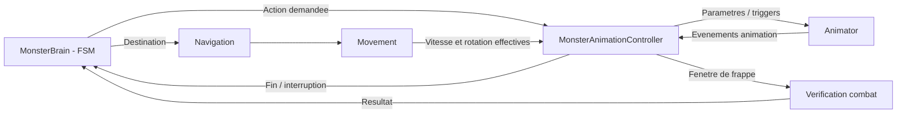
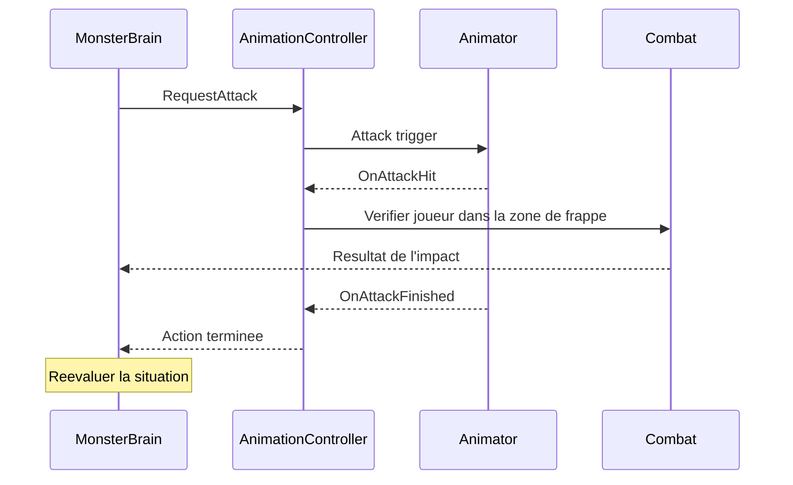

# Intégration des animations

> Proposition technique à ajuster lors de l'intégration dans Unity. Le catalogue et le graphe des animations existants restent la référence : [animations.md](../animations.md).

## 1. Deux graphes indépendants

- La FSM de l'IA décide du comportement : patrouiller, enquêter, chercher, poursuivre, attaquer, récupérer...
- L'Animator décide de l'enchaînement des clips et des transitions nécessaires pour représenter une action.

Un état d'IA peut utiliser plusieurs animations ; plusieurs états d'IA peuvent utiliser le même clip. Le monstre n'a pas d'état comportemental `Idle`, mais les clips `idle` et `idle_exhausted` restent disponibles pour les pauses et transitions appropriées. Il ne court jamais.

## 2. Correspondance avec le catalogue

Les clips indiqués sont les animations possibles, pas une séquence obligatoire jouée à chaque entrée dans un état.

| État / action                           | Clips existants                                                                            |
| --------------------------------------- | ------------------------------------------------------------------------------------------ |
| `Patrol`                                | `walk_start`, `limp_walk`, `walk_stop`, `turn_left`, `turn_right`                          |
| `Alert`                                 | `alert`                                                                                    |
| `Investigate`                           | `limp_walk`, `turn_left`, `turn_right`, `look_around`                                      |
| `Search`                                | `look_around`, `look_down`, `limp_walk`                                                    |
| Inspection sous table                   | `bend_down`, `look_under_table`, `bend_up`                                                 |
| `Chase`                                 | `limp_walk`, rotations, transitions de locomotion                                          |
| `Attack`                                | `arm_attack`                                                                               |
| `TargetLost`                            | `target_lost`                                                                              |
| `HitReaction`                           | `hit_reaction`                                                                             |
| Effet `Slow`                            | `limp_walk` avec déplacement et animation synchronisés                                     |
| `Stunned`                               | `stunned`                                                                                  |
| `Recover`                               | `stun_recovery` si récupération après étourdissement ; fin de réaction dans les autres cas |
| Arrêts et transitions                   | `idle`, `idle_exhausted`, `walk_start`, `walk_stop`                                        |
| Franchissement de porte (si nécessaire) | `door_duck`, `door_walk`, `door_stand`                                                     |

Toutes les animations du catalogue sont conservées, y compris celles de porte, qui ne sont pas nécessaires au MVP à une seule pièce. L'inspection sous une table demande une position et une orientation compatibles avec les collisions.

## 3. Paramètres proposés de l'Animator

| Paramètre      | Type    | Usage                                                     |
| -------------- | ------- | --------------------------------------------------------- |
| `Speed`        | Float   | Vitesse réelle de déplacement, transitions de locomotion. |
| `TurnAngle`    | Float   | Sens / amplitude de réorientation demandée.               |
| `IsStunned`    | Bool    | Maintient l'étourdissement tant que l'effet est actif.    |
| `Alert`        | Trigger | Réaction à une perception.                                |
| `LookAround`   | Trigger | Recherche visuelle.                                       |
| `LookDown`     | Trigger | Observation du sol.                                       |
| `InspectTable` | Trigger | Démarrage de la séquence d'inspection.                    |
| `TargetLost`   | Trigger | Réaction à la perte du joueur.                            |
| `Attack`       | Trigger | Lancement d'une attaque.                                  |
| `HitReaction`  | Trigger | Réaction à un impact.                                     |
| `Recover`      | Trigger | Récupération si nécessaire.                               |

Les noms sont indicatifs. Les triggers sont envoyés lors d'un changement ou d'une demande d'action, pas à chaque frame. L'adaptateur doit éviter les demandes répétées et signaler une action refusée ou interrompue.

## 4. Événements d'animation

| Événement proposé      | Rôle                                                                               |
| ---------------------- | ---------------------------------------------------------------------------------- |
| `OnAttackHit`          | Ouvrir la fenêtre de vérification réelle de l'impact (une seule fois par attaque). |
| `OnAttackFinished`     | Informer la FSM que l'action d'attaque peut se terminer.                           |
| `OnInspectionFinished` | Autoriser un nouveau point de recherche.                                           |
| `OnReactionFinished`   | Informer la FSM de la fin de la réaction à un impact.                              |
| `OnRecoveryFinished`   | Autoriser la reprise de comportement.                                              |
| `OnFootstep`           | Jouer un son de pas synchronisé avec la marche.                                    |

Les notifications peuvent être réalisées avec des Animation Events ou des callbacks de transitions d'état Animator. Chaque action possède un identifiant ou un mécanisme équivalent pour ignorer les événements d'une animation interrompue. Prévoir un délai de sécurité si un événement de fin n'est jamais reçu.

## 5. Exemple : attaque

L'animation ne décide ni d'infliger automatiquement un dégât ni de poursuivre le joueur. Le système de combat vérifie la portée, la collision et les obstacles au moment de l'impact ; la FSM choisit ensuite le comportement approprié.

## 6. Déplacements et interruptions

Proposition de départ : déplacement piloté par script, avec Animator synchronisé sur la vitesse effective. Le root motion n'est pas utilisé pour la locomotion tant que le suivi du chemin et les collisions n'ont pas été validés ; il pourra être évalué si les clips l'exigent. Éviter de déplacer le monstre simultanément par script et par root motion.

Un étourdissement valide peut interrompre une action conformément à [behavior.md](behavior.md) ; les événements d'une attaque annulée ne doivent plus déclencher de frappe. Si la frappe a déjà été appliquée, elle n'est pas annulée rétroactivement. La récupération et la durée d'étourdissement sont contrôlées par la logique de jeu ; l'Animator en représente la progression.

Les fenêtres interruptibles, paramètres précis de blend et synchronisation des pas restent à définir avec les animations disponibles. La FSM ne dépend pas du nom d'un clip en dur : l'adaptateur assure cette correspondance.
