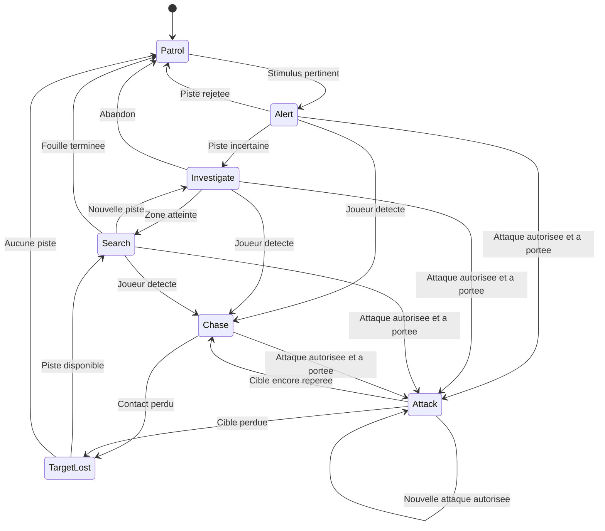
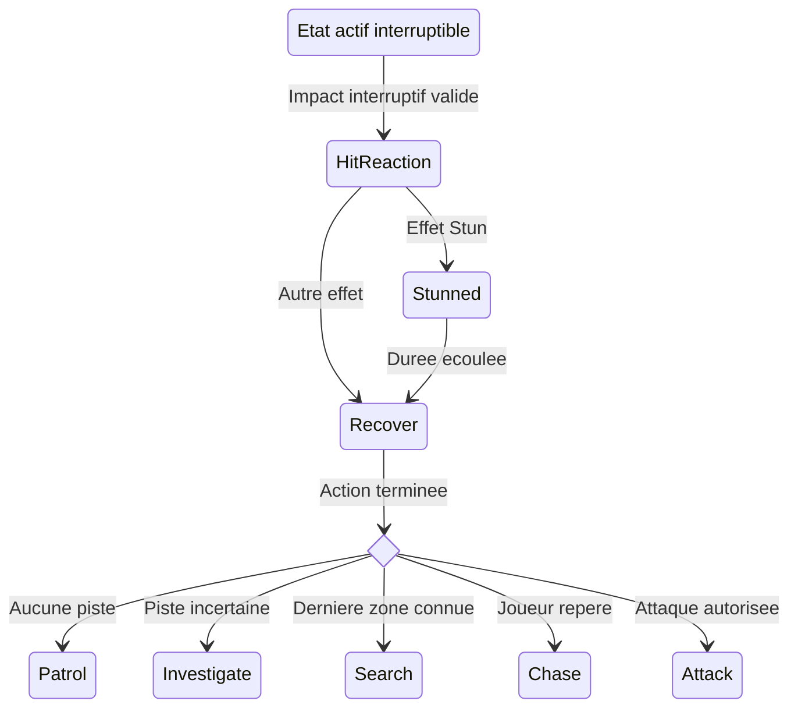

# Comportement et FSM

## 1. Principes

La FSM classique possède un seul état comportemental actif. Le comportement par défaut est `Patrol` : en l'absence de piste, le monstre cherche continuellement de nouvelles destinations. `Idle` appartient uniquement au graphe d'animation.

Le monstre se déplace toujours en marchant, même en poursuite. Il décide à partir des observations disponibles et de sa mémoire, sans lire la position réelle cachée du joueur.

## 2. États

| État          | Comportement                                                                   | Fin / transition                                                                                        |
| ------------- | ------------------------------------------------------------------------------ | ------------------------------------------------------------------------------------------------------- |
| `Patrol`      | Choisir et rejoindre des points de patrouille successifs.                      | Stimulus pertinent → `Alert`.                                                                           |
| `Alert`       | Réagir brièvement à un stimulus et évaluer sa nature.                          | Piste incertaine → `Investigate` ; joueur détecté → `Chase` ; attaque autorisée et à portée → `Attack`. |
| `Investigate` | Se déplacer vers une destination estimée à partir d'un indice.                 | Zone atteinte → `Search` ; joueur détecté → `Chase` ou `Attack` ; piste abandonnée → `Patrol`.          |
| `Search`      | Inspecter plusieurs points d'une zone suspecte, éventuellement sous une table. | Nouvelle piste → `Investigate` ; joueur détecté → `Chase` ou `Attack` ; recherche épuisée → `Patrol`.   |
| `Chase`       | Actualiser une destination estimée selon les observations du joueur.           | Attaque autorisée et à portée → `Attack` ; cible perdue après délai → `TargetLost`.                     |
| `Attack`      | Exécuter une attaque, avec fenêtre d'impact et récupération.                   | Après l'action → réévaluer : `Attack`, `Chase` ou `TargetLost`.                                         |
| `TargetLost`  | Enregistrer la dernière piste exploitable après perte de contact.              | Piste disponible → `Search` ; aucune piste → `Patrol`.                                                  |
| `HitReaction` | Réagir à un impact direct jugé interruptif.                                    | Selon effet → `Stunned` ou `Recover`.                                                                   |
| `Stunned`     | Interrompre la locomotion et l'attaque pendant l'étourdissement.               | Durée écoulée → `Recover`.                                                                              |
| `Recover`     | Terminer la récupération et réévaluer les pistes.                              | `Chase`, `Attack`, `Investigate`, `Search` ou `Patrol` selon la situation.                              |

`Slow` reste un modificateur temporaire de vitesse plutôt qu'un état exclusif, afin de pouvoir poursuivre ou patrouiller tout en étant ralenti. `Alert`, `TargetLost` et `HitReaction` restent des états brefs, distincts dans la FSM classique.

## 3. Graphe comportemental

Les interruptions par les items sont partagées dans le contrôleur de la FSM, sans état parent ni sous-FSM :

`Active` est un raccourci de diagramme, pas un état réel. `Resume` représente une évaluation instantanée. Un effet `Slow` non interruptif modifie seulement la vitesse et ne passe pas obligatoirement par `HitReaction`.

## 4. Choix des destinations

### Patrol

Proposition simple : sélectionner un point navigable atteignable dans la pièce. Éviter de reprendre immédiatement le même point ou les derniers points visités. Une fois arrivé, choisir une nouvelle destination sans attente prolongée. Si le chemin échoue, essayer un autre point.

### Investigate

Estimer une destination le long de la direction perçue. Tester des points navigables compatibles avec cette direction ; choisir un point atteignable. Une fois arrivé, lancer une recherche locale. Il n'est pas nécessaire de localiser exactement la source du stimulus.

### Search

Visiter des points proches de la dernière zone estimée, en privilégiant ceux qui n'ont pas encore été fouillés. Le monstre peut regarder autour de lui, au sol et, si une position d'inspection valide existe, sous les tables. Abandonner après épuisement de la piste ou du budget de recherche configuré.

### Chase et Attack

Actualiser la destination lorsque les observations indiquent une nouvelle direction. En cas de perte de vue, poursuivre au plus vers la dernière estimation pendant le délai prévu, puis rechercher. Une ancienne piste de catégorie `Attack` ne suffit pas à déclencher une attaque : il faut une détection actuelle suffisante, une attaque autorisée, le cooldown écoulé, une portée `attackRange` compatible et aucun obstacle bloquant. `attackDistance` est seulement la limite de la catégorie visuelle `Attack`. Le capteur ou le combat peut fournir un résultat booléen à la FSM sans lui donner la position exacte du joueur. À la fenêtre d'impact de l'animation, le combat vérifie de nouveau la présence du joueur dans la zone de frappe et les obstacles ; une attaque ratée n'applique aucune conséquence.

## 5. Priorités

Les interruptions directes valides respectent l'action courante et ses règles d'interruption ; `Stun` suspend le comportement normal jusqu'à récupération. Une attaque autorisée prime sur une simple investigation, et une poursuite avec contact visuel confirmé prime sur un bruit ordinaire. Une nouvelle observation pertinente peut rediriger une investigation ou une recherche. Sans piste exploitable, retour à `Patrol`.

> Voir [perception](perception.md), [mémoire](memory.md), [navigation](navigation.md) et [réactions aux items](item_reactions.md).
