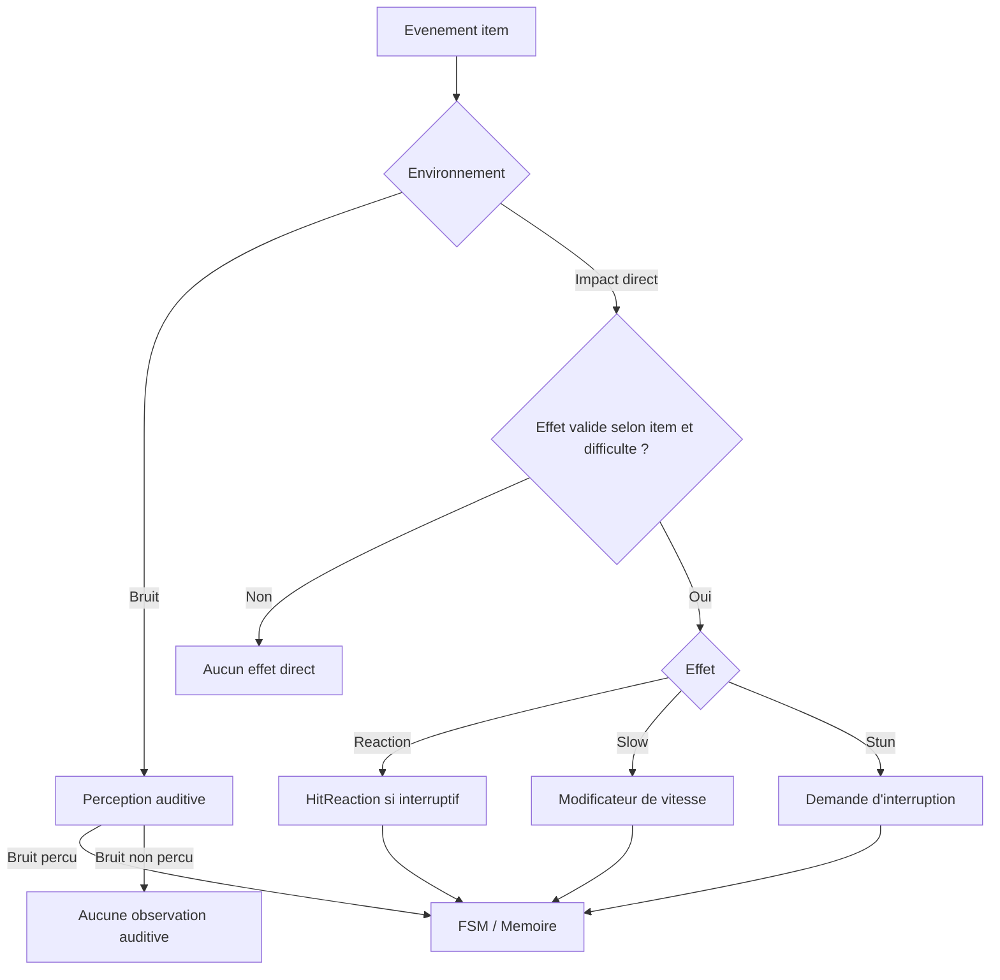

# Réactions du monstre aux items

## 1. Principes

Le monstre est immortel. Les objets peuvent servir à le distraire, provoquer une réaction à un impact, le ralentir ou l'étourdir temporairement. Ils n'infligent pas de dégâts mortels et il n'y a pas de système de points de vie du monstre prévu.

La logique d'un objet reste dans le système d'items. L'IA interprète les événements selon la perception, la configuration de l'objet, le profil de difficulté et le comportement courant. Les distractions proviennent des bruits environnementaux effectivement perçus.

## 2. Deux types d'événements

| Événement     | Traitement                                                                                                                           |
| ------------- | ------------------------------------------------------------------------------------------------------------------------------------ |
| `NoiseEvent`  | Le capteur auditif exclut les bruits liés au monstre, puis vérifie le seuil et la portée ; la FSM juge la pertinence du bruit perçu. |
| `ImpactEvent` | Si le monstre a été directement touché, évaluer les règles d'impact direct de l'item.                                                |

Un impact sonore n'implique pas un étourdissement. Un impact direct peut produire les deux événements ; ils ne doivent pas appliquer deux fois le même effet direct. Le bruit, l'effet direct et la casse sont évalués indépendamment.

## 3. Effets

| Effet      | Conséquence                                                            |
| ---------- | ---------------------------------------------------------------------- |
| `None`     | Aucun effet direct ; un bruit peut toutefois être perçu.               |
| `Reaction` | Réaction ponctuelle à l'impact, sans neutralisation prolongée.         |
| `Slow`     | Réduction temporaire de la vitesse, sans immobilisation complète.      |
| `Stun`     | Interruption et immobilisation temporaire, suivies d'une récupération. |

`Reaction` peut provoquer `HitReaction` sans ralentissement ni étourdissement si l'action courante est interruptible. `Slow` applique temporairement un modificateur au contrôleur de déplacement, même pendant `Patrol`, `Investigate`, `Search` ou `Chase`. `Stun` utilise les états `HitReaction`, `Stunned` et `Recover`.

### Application proposée

1. Vérifier que l'item a touché le monstre et que l'événement est valide.
2. Recevoir `impactStrength`, calculé par les [interactions physiques des items](../../gameplay/items/environment_interactions.md) à partir de la masse et de la vitesse avant impact.
3. Pour chaque règle configurée, calculer `effectiveThreshold = rule.minImpactStrength * impactThresholdMultiplier` ; elle est éligible si `impactStrength >= effectiveThreshold` et si le monstre a bien été touché.
4. Retenir pour la première version le seul effet éligible le plus important : `Stun > Slow > Reaction > None`. Cela évite plusieurs effets directs automatiques pour une collision ; la durée effective dépend du profil lorsque l'effet en comporte une.
5. Consulter l'autorisation d'interruption de l'action courante ; une action non interruptible n'est pas interrompue arbitrairement et une frappe déjà appliquée n'est pas annulée rétroactivement.
6. Après récupération, réévaluer les perceptions et pistes encore valides, sans retrouver magiquement la position du joueur.

Une collision pendant `Stunned` ne prolonge pas automatiquement l'étourdissement. Le cumul des effets entre collisions distinctes sera fixé pendant les tests.

## 4. Gestion des priorités

Un bruit inférieur au seuil d'audition ne produit aucune observation auditive ; un impact direct inférieur aux seuils d'effet ne provoque aucune réaction directe. Ces seuils sont indépendants. Une poursuite avec contact visuel confirmé prime sur un bruit ordinaire ; une réaction directe valide suit les règles d'interruption de l'action courante. Après récupération, la FSM réévalue les informations encore valides.

Les effets précis des cailloux, fioles et torche restent à définir dans le [catalogue](../../gameplay/items/catalog.md). La lumière de la torche n'est pas perçue spécifiquement au MVP.

Voir [spécifications des items](../../gameplay/items/specifications.md), [catalogue](../../gameplay/items/catalog.md), [behavior.md](behavior.md) et [difficulty.md](difficulty.md).
