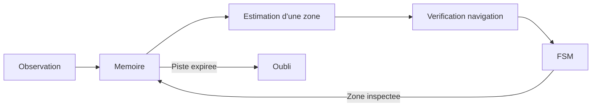

# Mémoire et estimation

> Proposition de première implémentation, à ajuster après intégration. Le but est de donner au monstre une persistance crédible sans système de localisation complexe.

## 1. Rôle

La perception informe le monstre de ce qu'il détecte maintenant. La mémoire lui permet d'agir après la disparition du stimulus : rejoindre une zone suspecte, la fouiller, oublier une piste et repartir patrouiller.

La mémoire ne stocke jamais la vraie position cachée du joueur. Une position estimée peut être fausse et n'est pas équivalente à une position observée précisément.

## 2. Données conservées

Pour la première version, conserver la dernière piste visuelle, la dernière piste sonore et les points déjà visités durant la recherche courante. Une liste complète de tous les stimuli n'est pas nécessaire.

| Champ d'une piste      | Description                                                          |
| ---------------------- | -------------------------------------------------------------------- |
| `kind`                 | Visuelle ou sonore.                                                  |
| `origin`               | Position du monstre lors de la perception.                           |
| `direction`            | Direction reçue au moment de la perception.                          |
| `lastSeenAt`           | Instant de dernière observation de cette piste (visuelle ou sonore). |
| `visualBand`           | Catégorie de distance lorsqu'elle existe.                            |
| `estimatedDestination` | Point navigable estimé, calculé à partir de la piste.                |
| `visitedSearchPoints`  | Points déjà inspectés, associés à la recherche en cours.             |

`visitedSearchPoints` appartient au contexte de recherche, plutôt qu'à chaque piste si une seule recherche est active. `estimatedDestination` peut également être calculé à la demande.



## 3. Estimation à partir d'une direction

Une direction ne suffit pas à retrouver une position exacte. On choisit plutôt des destinations candidates sur le NavMesh.

```text
pointCandidate = origin + direction * distanceEstimee
```

Pour le déplacement, projeter la direction sur le plan de navigation. Choisir une distance d'essai configurée : pour une observation visuelle, elle peut dépendre de la catégorie de distance ; pour un bruit, choisir une distance d'investigation générique. Cette distance n'est pas la véritable distance de la source.



1. Échantillonner des candidats dans cette direction et éventuellement autour d'elle.
2. Projeter les candidats sur le NavMesh avec une tolérance limitée.
3. Éliminer les destinations inaccessibles, invalides ou trop éloignées de la direction voulue.
4. Retenir une destination plausible ; en cas d'échec, poursuivre la recherche depuis une autre estimation ou abandonner.

La position du monstre à l'instant de perception est conservée pour ne pas déplacer artificiellement l'origine d'une ancienne piste lorsqu'il marche.
Les correspondances sont `observation.observerPosition -> track.origin` et `observation.timestamp -> track.lastSeenAt`. Les destinations estimées peuvent être conservées, mais pas la position réelle du joueur ni celle d'une source sonore. L'intensité éventuelle d'un bruit ne fournit pas sa distance exacte.

## 4. Mise à jour et oubli

| Événement                     | Comportement proposé                                                                   |
| ----------------------------- | -------------------------------------------------------------------------------------- |
| Nouvelle observation visuelle | Remplacer ou actualiser la piste visuelle.                                             |
| Nouveau bruit pertinent       | Actualiser la piste sonore.                                                            |
| Perte de vue                  | Conserver la dernière piste visuelle et son estimation.                                |
| Point inspecté                | Le marquer comme visité pour ne pas y retourner immédiatement.                         |
| Piste expirée                 | La supprimer ; ne plus l'utiliser pour décider.                                        |
| Recherche terminée            | Invalider la piste suivie si elle n'a pas été confirmée.                               |
| Étourdissement                | Laisser vieillir les pistes ; réévaluer celles qui restent valides après récupération. |

Pour commencer, la validité d'une piste dépend seulement de son âge et d'une durée de conservation configurée. Un score de confiance continu ou une carte probabiliste ne sont pas nécessaires.

## 5. Exploitation

Une piste visuelle récente peut être prioritaire sur un bruit ordinaire. En l'absence de vue actuelle, la FSM s'appuie sur la dernière estimation, puis inspecte des points proches. Une nouvelle observation pertinente peut rediriger la recherche ; elle ne doit pas automatiquement faire changer de destination à chaque tick.

Si aucune piste n'est exploitable, le monstre reprend `Patrol`. Les durées, paramètres de projection, priorités et stratégie de sélection des points restent à ajuster. Voir [behavior.md](behavior.md) et [difficulty.md](difficulty.md).
