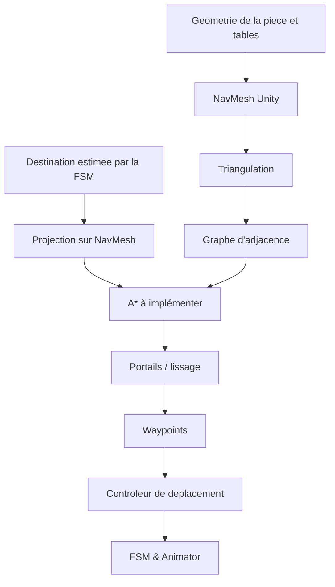

# Navigation et pathfinding

## 1. Choix retenus

Unity génère le NavMesh ; notre code construit le graphe, calcule les chemins avec A* et pilote le déplacement du monstre. Les tables sont détectées via QR codes avant chaque partie, puis restent fixes pendant cette partie du MVP. Le NavMesh est régénéré au lancement de chaque nouvelle configuration, pas à chaque frame.

## 2. Génération du NavMesh

1. Obtenir la géométrie de collision de la pièce et les positions/orientations des tables calibrées.
2. Positionner les obstacles et définir les surfaces navigables.
3. Configurer les dimensions de l'agent (rayon et hauteur) selon le volume du monstre et les passages autorisés.
4. Construire le NavMesh à l'exécution, par exemple avec `NavMeshSurface`.
5. Extraire la triangulation via `NavMesh.CalculateTriangulation` et construire notre graphe à partir de la surface de navigation dédiée au monstre.

La géométrie visible et les collisions de référence peuvent être différentes ; la navigation doit rester compatible avec les obstacles physiques. Les paramètres de passage sous une table ou les portes ne sont pas implicitement autorisés par une animation.

## 3. Graphe de navigation

Proposition : représenter chaque triangle navigable par un nœud. Relier deux triangles lorsqu'ils partagent une arête praticable, stockée comme portail.

| Élément | Données                                   |
| ------- | ----------------------------------------- |
| Nœud    | Identifiant, sommets, centroïde, voisins. |
| Arête   | Nœud voisin, coût, portail partagé.       |
| Graphe  | Liste des nœuds et relations d'adjacence. |

Construire les adjacences à partir des arêtes communes. Prévoir une tolérance pour des sommets géométriquement identiques mais d'indices différents ; ne pas relier des surfaces séparées par un obstacle. Les triangles dégénérés ou liens non praticables doivent être exclus.

## 4. A*

A* cherche un chemin de coût minimal sur le graphe choisi. Il utilise `f(n) = g(n) + h(n)` :

| Terme            | Proposition                                                                     |
| ---------------- | ------------------------------------------------------------------------------- |
| `g(n)`           | Coût cumulé depuis le triangle de départ.                                       |
| Coût d'une arête | Distance euclidienne entre centroïdes adjacents.                                |
| `h(n)`           | Distance euclidienne entre le centroïde courant et celui du triangle d'arrivée. |
| Open set         | File de priorité ordonnée par `f`.                                              |
| Prédécesseurs    | Reconstruction du chemin à la fin.                                              |

Projeter le départ et la destination sur le NavMesh avec une tolérance limitée, puis identifier leurs triangles. Si la destination est inaccessible ou le graphe déconnecté, retourner un échec explicite plutôt que de déplacer le monstre à travers un mur.

Le résultat de A* est une suite de triangles, pas une trajectoire finale. Le choix de coûts ci-dessus optimise le chemin sur ce graphe, pas nécessairement la distance géométrique globale dans la pièce.

## 5. Construction et suivi du chemin

La suite de portails permet de calculer des waypoints. Le **Funnel algorithm** est envisagé pour obtenir un chemin plus direct à l'intérieur du corridor navigable ; pour une première implémentation, suivre des points de portails valides peut suffire. Toute simplification doit conserver le passage à l'intérieur de la surface navigable.

Le contrôleur de déplacement suit les waypoints avec une vitesse et une rotation compatibles avec la marche boiteuse. Il signale l'arrivée, le blocage ou l'échec à la FSM et fournit la vitesse effective à l'Animator.

| Situation                                      | Réaction proposée                                                      |
| ---------------------------------------------- | ---------------------------------------------------------------------- |
| Nouveau point de patrouille                    | Calculer un chemin.                                                    |
| Destination de poursuite sensiblement modifiée | Recalculer, avec une limite de fréquence.                              |
| Chemin devenu inutilisable / monstre bloqué    | Arrêter le déplacement, demander un recalcul ou une autre destination. |
| Étourdissement                                 | Suspendre le mouvement ; réévaluer le chemin après récupération.       |
| Destination atteinte                           | Informer la FSM.                                                       |

La navigation n'a pas accès à la position cachée du joueur : elle reçoit seulement des destinations choisies à partir des observations ou de la mémoire. Le recalcul continu de la géométrie, les tables mobiles pendant la partie et les couloirs / autres pièces restent des extensions.

Voir [animation_integration.md](animation_integration.md) pour le lien entre locomotion et animation. Les tailles, tolérances, fréquences et vitesses seront réglées pendant l'implémentation et les tests.
