# Perception

## 1. Principes

Le monstre évolue dans un environnement partiellement observable. Au MVP, il dispose de deux sens : **vision** et **audition**. Le module de perception utilise les données réelles de Unity pour effectuer les tests, mais transmet uniquement des observations limitées à la FSM et à la mémoire.

## 2. Vision

La vision est volontairement mauvaise pour que le joueur puisse se dissimuler dans une pièce unique. Le cône de vision recherche le joueur, pas les sources lumineuses : la lumière de la torche n'est pas un stimulus visuel autonome au MVP. Le cône dépend d'une orientation, d'un champ de vision (`visionFov`) et de distances configurables.



Schéma de principe : trois zones de distance à l'intérieur du même cône, sans valeurs numériques. `Attack` est la plus courte, puis `Chase`, puis `Investigate`.

| Zone          | Observation                                                          | Comportement permis    |
| ------------- | -------------------------------------------------------------------- | ---------------------- |
| `Investigate` | Joueur aperçu à distance ; direction connue, distance approximative. | Enquêter.              |
| `Chase`       | Joueur suffisamment détecté ; direction et catégorie de proximité.   | Poursuivre.            |
| `Attack`      | Joueur proche et visible selon `attackDistance`.                     | Envisager une attaque. |

Les trois zones sont des intervalles de distance dans un seul cône : `0 < attackDistance <= chaseDistance <= investigateDistance`. `attackDistance` classe une observation visuelle ; `attackRange` désigne la portée physique de la frappe et peut avoir une autre origine de mesure. Aucune relation numérique supplémentaire n'est imposée entre eux.

### Détection proposée

Le cône de vision sert uniquement à vérifier si le joueur se trouve dans le champ de vision du monstre. Il ne nécessite pas de générer un maillage conique ni de lancer des rayons dans toutes les directions : un test d'angle, un test de distance et un raycast vers le joueur suffisent.

1. Calculer le vecteur du point de perception du monstre vers un point représentatif du joueur.
2. Vérifier la distance maximale de perception.
3. Calculer l'angle entre la direction du regard et la direction vers le joueur à l'aide du produit scalaire.
4. Vérifier la ligne de vue par raycast du monstre vers le joueur, afin de détecter les murs et les tables qui pourraient l'occulter.
5. Si les trois tests réussissent, produire une observation contenant la position propre du monstre, une direction normalisée, la catégorie de détection et l'instant de perception.

Les tests de distance et d'angle peuvent être effectués avant le raycast pour éviter un test de collision inutile si le joueur est déjà hors du cône.

### Calcul de l'angle par produit scalaire



On définit les deux vecteurs unitaires suivants :

- `forward` : direction du regard du monstre (`eyeTransform.forward`).
- `toPlayer` : direction du point de perception du monstre vers le point représentatif du joueur.

```text
v = playerPosition - monsterEyePosition
distance = length(v)
toPlayer = normalize(v)
forward = normalize(monsterForward)

dot = Dot(forward, toPlayer)
angle = acos(clamp(dot, -1, 1))
```

Pour deux vecteurs normalisés, le produit scalaire est égal au cosinus de l'angle qui les sépare. Ici, `visionFov` désigne **l'ouverture totale du cône** : le demi-angle maximal autorisé de chaque côté de `forward` vaut donc `visionFov / 2`.

Le joueur se trouve dans le cône si :

```text
angle <= visionFov / 2
```

On peut éviter le calcul de `acos` en comparant directement le produit scalaire au cosinus du demi-angle :

```text
Dot(forward, toPlayer) >= cos(visionFov / 2)
```

Dans Unity, si `visionFov` est exprimé en degrés, le seuil se calcule avec `Mathf.Cos(visionFov * 0.5f * Mathf.Deg2Rad)`. Le test s'effectue en 3D ; le schéma représente une coupe du cône. Le cas d'une distance nulle doit être traité avant la normalisation.

### Raycast et ligne de vue

Un raycast est lancé depuis le point de perception du monstre, dans la direction `toPlayer`, jusqu'à la distance du joueur. Si un obstacle opaque est rencontré avant le point cible, le joueur n'est pas visible, même s'il se trouve dans le cône.

Pour le MVP, on peut utiliser un masque de collision ne contenant que les obstacles susceptibles de bloquer la vision (murs, tables, etc.) et excluant le monstre et le joueur lui-même. La ligne de vue est libre si aucun de ces obstacles n'est touché avant le point cible.

```text
withinDistance = distance <= investigateDistance
withinFov = Dot(forward, toPlayer) >= cos(visionFov / 2)
lineOfSight = NOT Raycast(monsterEyePosition, toPlayer, distance, obstacleMask)

seesPlayer = withinDistance AND withinFov AND lineOfSight
```

Le point de perception peut être un `Transform` proche de la tête. Un point représentatif du joueur suffit pour commencer ; la visibilité partielle (plusieurs points) pourra être affinée. Le choix du point exact et de la prise en compte du mouvement de tête sera fixé pendant l'implémentation et les tests.

Si le joueur est visible, le capteur classe sa distance : `distance <= attackDistance` donne `Attack`, sinon `distance <= chaseDistance` donne `Chase`, sinon `distance <= investigateDistance` donne `Investigate`. En dehors de cette portée ou si la visibilité échoue, aucune nouvelle observation visuelle valide n'est produite. Le capteur utilise la distance exacte en interne, mais transmet seulement la catégorie et la direction géométrique à la FSM et à la mémoire, sans position réelle du joueur ni erreur angulaire aléatoire supplémentaire au MVP.

`visionAcquireDelay` confirme une détection ; `visionLoseDelay` tolère une perte temporaire de contact ; `chasePersistence` prolonge la poursuite vers la dernière estimation après la perte confirmée. Ne pas appliquer deux fois un délai de même responsabilité. Une observation conservée pendant `visionLoseDelay` ne confirme pas une visibilité physique actuelle pour le combat. Un obstacle bloque la détection, et aucune attaque ne doit toucher le joueur à travers lui.

## 3. Audition

Tout item physique peut émettre un `NoiseEvent` lors d'une collision significative, y compris après un rebond. L'intensité dépend de la vitesse juste avant cette collision (voir [interactions](../../gameplay/items/environment_interactions.md)). Le capteur reçoit la position, l'intensité, le type, l'origine et, si pertinent, la cible touchée ; il exclut les bruits produits par le monstre et ceux des collisions qui le touchent, sans empêcher leur lecture sonore pour le joueur.

Proposition de détection minimale :

```text
impactSpeed = length(preImpactVelocity)
noiseIntensity = k * impactSpeed
heard = NOT isMonsterRelatedNoise
        AND noiseIntensity >= hearingThreshold
        AND distanceToSource <= hearingRange
```

Le système sensoriel connaît la position de la source pour réaliser ces tests. Si le bruit est trop faible ou trop éloigné, aucune observation auditive n'est produite. S'il est perçu, le capteur fournit la position propre du monstre, la direction normalisée, l'instant et éventuellement l'intensité ; la FSM décide ensuite de sa pertinence selon la mémoire et l'état courant. Il ne fournit ni position exacte ni distance exacte de la source, et l'intensité ne sert pas directement de mesure de distance.

Pas de simulation acoustique, matériau, masse ni propagation complexe. La perception des pas du joueur, l'occlusion acoustique et la perception de la lumière de la torche restent des [extensions](../../extensions.md).

## 4. Format d'observation proposé

| Champ              | Rôle                                                           |
| ------------------ | -------------------------------------------------------------- |
| `kind`             | Vision ou audition.                                            |
| `observerPosition` | Position propre du monstre au moment de l'observation.         |
| `direction`        | Direction normalisée de la piste.                              |
| `timestamp`        | Temps de l'observation.                                        |
| `visualBand`       | `Investigate`, `Chase` ou `Attack`, uniquement pour la vision. |
| `intensity`        | Intensité du stimulus sonore, si utile.                        |

L'origine propre est nécessaire pour réutiliser une direction plus tard ; elle ne révèle aucune coordonnée cachée du joueur. Les formats précis seront ajustés avec [memory.md](memory.md).

Voir [difficulty.md](difficulty.md) pour les paramètres et profils. Les valeurs seront définies pendant les tests en jeu.
