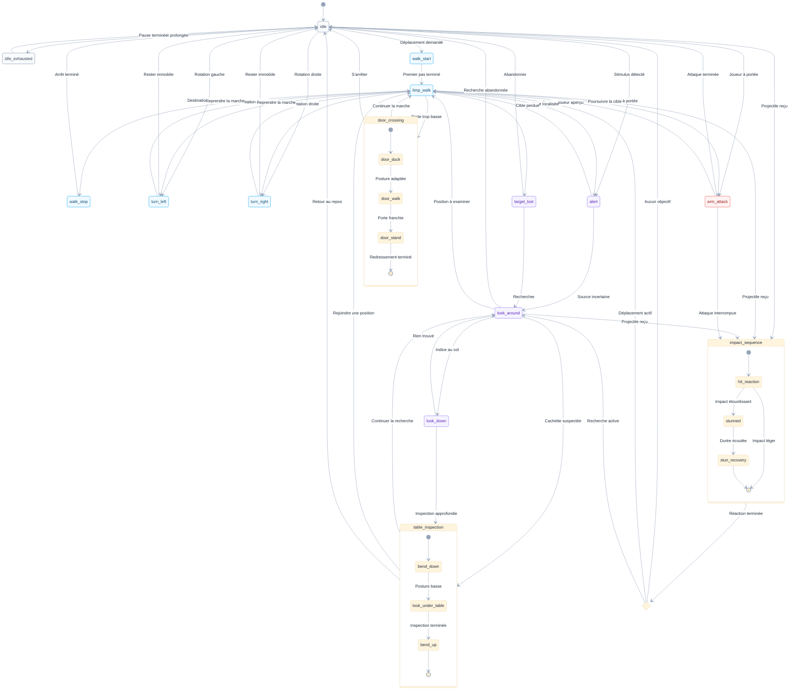

# Animations du monstre

> Objet : définir les animations à capturer, leurs intentions de jeu et leurs transitions avant la création du contrôleur d'animation.

## Description

Le monstre est un humanoïde d'environ 3 mètres de haut, très maigre, aux bras disproportionnellement longs. Il garde le dos voûté, la tête basse et les épaules tombantes. Il paraît épuisé, presque indifférent : chaque geste lui coûte un effort. Il boite en permanence et ne court jamais, y compris lorsqu'il poursuit le joueur. Son danger repose sur son allonge, sa persistance et sa présence physique, pas sur sa vitesse.

Il évolue dans un environnement réel : il doit se baisser pour franchir les portes d'environ 2 mètres, se pencher pour examiner le dessous des tables et peut être étourdi par des objets que le joueur lui lance.

## Table des matières

- [Animations du monstre](#animations-du-monstre)
  - [Description](#description)
  - [Table des matières](#table-des-matières)
  - [Graphe d'états et transitions](#graphe-détats-et-transitions)
  - [Concept du monstre](#concept-du-monstre)
      - [1. Silhouette](#1-silhouette)
      - [2. Énergie](#2-énergie)
      - [3. Locomotion](#3-locomotion)
      - [4. Perception](#4-perception)
      - [5. Menace](#5-menace)
      - [6. Environnement](#6-environnement)
      - [7. Émotion dominante](#7-émotion-dominante)
    - [Principes communs d'animation](#principes-communs-danimation)
      - [1. Ne jamais le redresser complètement](#1-ne-jamais-le-redresser-complètement)
      - [2. Conserver la même jambe boiteuse](#2-conserver-la-même-jambe-boiteuse)
      - [3. Privilégier l'inertie](#3-privilégier-linertie)
      - [4. Limiter l'amplitude inutile](#4-limiter-lamplitude-inutile)
      - [5. Faire respirer les pauses](#5-faire-respirer-les-pauses)
      - [6. Maintenir le contact avec le sol](#6-maintenir-le-contact-avec-le-sol)
      - [7. Prévoir les interruptions](#7-prévoir-les-interruptions)
      - [8. Distinguer animation et logique de jeu](#8-distinguer-animation-et-logique-de-jeu)
  - [Catalogue des animations](#catalogue-des-animations)
    - [A01 — Attente voûtée (`idle`)](#a01--attente-voûtée-idle)
    - [A02 — Pause d'épuisement (`idle_exhausted`)](#a02--pause-dépuisement-idle_exhausted)
    - [A03 — Marche boiteuse (`limp_walk`)](#a03--marche-boiteuse-limp_walk)
    - [A04 — Départ pénible (`walk_start`)](#a04--départ-pénible-walk_start)
    - [A05 — Arrêt lourd (`walk_stop`)](#a05--arrêt-lourd-walk_stop)
    - [A06 — Rotation vers la gauche (`turn_left`)](#a06--rotation-vers-la-gauche-turn_left)
    - [A07 — Rotation vers la droite (`turn_right`)](#a07--rotation-vers-la-droite-turn_right)
    - [A08 — Prise de conscience (`alert`)](#a08--prise-de-conscience-alert)
    - [A09 — Recherche visuelle (`look_around`)](#a09--recherche-visuelle-look_around)
    - [A10 — Regard vers le sol (`look_down`)](#a10--regard-vers-le-sol-look_down)
    - [A11 — Se pencher vers une table (`bend_down`)](#a11--se-pencher-vers-une-table-bend_down)
    - [A12 — Se relever après inspection (`bend_up`)](#a12--se-relever-après-inspection-bend_up)
    - [A13 — Se baisser devant une porte (`door_duck`)](#a13--se-baisser-devant-une-porte-door_duck)
    - [A14 — Franchir une porte courbé (`door_walk`)](#a14--franchir-une-porte-courbé-door_walk)
    - [A15 — Retrouver sa posture après la porte (`door_stand`)](#a15--retrouver-sa-posture-après-la-porte-door_stand)
    - [A16 — Attaque lente à longue portée (`arm_attack`)](#a16--attaque-lente-à-longue-portée-arm_attack)
    - [A17 — Réaction à un objet reçu (`hit_reaction`)](#a17--réaction-à-un-objet-reçu-hit_reaction)
    - [A18 — Étourdissement (`stunned`)](#a18--étourdissement-stunned)
    - [A19 — Récupération après étourdissement (`stun_recovery`)](#a19--récupération-après-étourdissement-stun_recovery)
    - [A20 — Perte de la cible (`target_lost`)](#a20--perte-de-la-cible-target_lost)
    - [A21 — Observation sous une table (`look_under_table`)](#a21--observation-sous-une-table-look_under_table)
    - [Transitions fonctionnelles](#transitions-fonctionnelles)
      - [Attente et déplacement](#attente-et-déplacement)
      - [Perception et inspection](#perception-et-inspection)
      - [Franchissement d'une porte](#franchissement-dune-porte)
      - [Attaque, impact et récupération](#attaque-impact-et-récupération)
    - [Hiérarchie des interruptions](#hiérarchie-des-interruptions)

## Graphe d'états et transitions

## Concept du monstre

#### 1. Silhouette

Environ 3 mètres, corps longiligne, bras presque pendants jusqu'aux genoux ou plus bas suivant le modèle, dos constamment arrondi.

#### 2. Énergie

Très faible. Les changements d'attitude prennent du temps ; les gestes commencent tard, s'interrompent parfois et se terminent difficilement.

#### 3. Locomotion

Marche lente, asymétrique, avec boiterie constante. Une jambe porte davantage le poids ; l'autre suit avec retard. Le côté de la boiterie devra rester identique dans tous les clips.

#### 4. Perception

Réagit avec un décalage perceptible à un bruit ou à la vue du joueur ; la tête bouge généralement avant les épaules et le bassin.

#### 5. Menace

Pas de sprint, ni de bonds. Une attaque est précédée d'une préparation lourde, puis d'une extension de bras suffisamment ample pour atteindre le joueur.

#### 6. Environnement

Portes basses, meubles, obstacles, sols réels et objets projetés par les joueurs.

#### 7. Émotion dominante

Lassitude inquiétante plutôt que colère ou agitation.

### Principes communs d'animation

#### 1. Ne jamais le redresser complètement

Sa posture « normale » reste déjà voûtée ; après une porte ou une inspection, il revient à cette posture, pas à une station droite humaine.

#### 2. Conserver la même jambe boiteuse

L'asymétrie doit rester cohérente entre marche, départ, arrêt, rotation et passage de porte. Ne pas inverser naïvement les clips en miroir.

#### 3. Privilégier l'inertie

Le bassin commence à bouger, puis le torse suit ; la tête et les bras réagissent avec un léger décalage. Les arrêts ne sont jamais nets, sauf choc extérieur.

#### 4. Limiter l'amplitude inutile

Les bras pendent et accompagnent peu la marche. La fatigue se traduit par une économie de mouvement, non par des secousses permanentes.

#### 5. Faire respirer les pauses

Plusieurs états comportent de courtes immobilités : avant de tourner, après avoir entendu un bruit, au milieu d'une inspection, après une attaque.

#### 6. Maintenir le contact avec le sol

Les pieds ne doivent pas glisser ; une éventuelle main d'appui sur un meuble ou un encadrement sera ajustée par IK dans Unity.

#### 7. Prévoir les interruptions

Un impact d'objet peut interrompre la plupart des actions, mais la transition doit préserver la pose actuelle, notamment sous une porte ou une table.

#### 8. Distinguer animation et logique de jeu

Voir le joueur, entendre un objet, savoir qu'une porte est proche ou entrer à portée d'attaque sont des décisions de l'IA, pas des animations en elles-mêmes.

## Catalogue des animations

**Priorités :** P0 = indispensable à la première version jouable ; P1 = enrichissement.

**Types :** boucle = mouvement répétable ; unique = action jouée une fois ; maintien = posture prolongeable.

### A01 — Attente voûtée (`idle`)

**Type :** boucle · **Priorité :** P0 · **Durée indicative :** 6–10 s

- **Intention :** donner l'impression d'un corps debout uniquement parce qu'il n'a pas encore eu la force de s'asseoir.

- **Départ :** pieds espacés de manière irrégulière, jambe valide portant davantage le poids ; genoux légèrement fléchis ; bassin projeté en arrière ; colonne courbée ; épaules et tête tombantes.

- **Déroulement :** respiration profonde mais discrète qui soulève le dos ; déplacement très lent du poids d'un pied à l'autre ; tête qui s'affaisse puis revient légèrement ; doigts relâchés et bras presque immobiles.

- **Fin / boucle :** retrouver exactement la pose de départ pour ne pas voir de saut au raccord. Éviter de regarder en permanence autour de soi.

- **Transitions :** vers [A03](#a03) / [A04](#a04), [A08](#a08) ou [A02](#a02) ; retour depuis [A19](#a19) et [A20](#a20).

- **Capture :** boucle de 6 à 10 s, corps entier visible, sans pas et sans déplacement du bassin dans l'espace.

### A02 — Pause d'épuisement (`idle_exhausted`)

**Type :** unique · **Priorité :** P1 · **Durée indicative :** 4–7 s

- **Intention :** montrer que même une simple attente lui demande un effort.

- **Départ :** posture [A01](#a01).

- **Déroulement :** expiration longue ; épaules qui s'affaissent davantage ; tête qui descend ; léger pli des genoux ; une main peut venir se poser sur la cuisse ou le genou. Quelques secondes de quasi-immobilité suivent.

- **Fin :** retirer lentement la main, redéployer un peu le torse, revenir à [A01](#a01) sans retrouver une posture droite.

- **Transitions :** [A01](#a01) → [A02](#a02) → [A01](#a01), seulement lorsqu'il n'est ni menacé ni occupé.

- **Capture :** 4 à 7 s, une prise complète avec entrée et sortie ; aucune exagération comique du souffle.

### A03 — Marche boiteuse (`limp_walk`)

**Type :** boucle · **Priorité :** P0 · **Durée indicative :** 3–5 s / cycle

- **Intention :** seul mode de déplacement habituel, même en poursuite. La silhouette doit être immédiatement reconnaissable.

- **Départ :** posture [A01](#a01), même côté de jambe faible pour toutes les prises.

- **Déroulement :** le pied de la jambe valide avance et reçoit le poids du corps ; la jambe faible est ramenée tardivement, avec pas plus court et appui plus prudent. Le bassin oscille de façon dissymétrique ; le torse reste courbé ; la tête suit le mouvement avec retard. Les bras longs restent relâchés, avec un balancement minimal.

- **Fin / boucle :** capturer au moins un cycle complet des deux jambes, en cherchant une continuité de pose et de vitesse entre le début et la fin. Pas d'accélération vers une course.

- **Transitions :** [A01](#a01) / [A04](#a04) → [A03](#a03) → [A05](#a05) / [A01](#a01), [A06](#a06) / [A07](#a07), [A08](#a08), [A13](#a13) ou [A16](#a16).

- **Capture :** plusieurs cycles à vitesse stable, idéalement sur place pour tester d'abord une locomotion pilotée par le NavMeshAgent ; conserver une prise avec déplacement réel comme référence.

### A04 — Départ pénible (`walk_start`)

**Type :** unique · **Priorité :** P1 · **Durée indicative :** 1,5–3 s

- **Intention :** rendre visible le temps nécessaire pour vaincre l'inertie.

- **Départ :** pose [A01](#a01), poids surtout sur la jambe valide.

- **Déroulement :** la tête s'oriente légèrement ; le bassin se décale ; un pied se décolle tardivement ; le premier pas est court et hésitant. Les épaules ne se redressent pas au départ.

- **Fin :** le second appui se raccorde au cycle de [A03](#a03) sans accélération brutale.

- **Transitions :** [A01](#a01) → [A04](#a04) → [A03](#a03).

- **Capture :** 1,5 à 3 s ; commencer et finir dans des poses clairement identifiées.

### A05 — Arrêt lourd (`walk_stop`)

**Type :** unique · **Priorité :** P1 · **Durée indicative :** 1–2,5 s

- **Intention :** le monstre ne s'immobilise pas proprement ; il laisse mourir son élan.

- **Départ :** en cours de marche [A03](#a03).

- **Déroulement :** dernier pas légèrement plus lourd ; bassin qui dépasse un peu le point d'arrêt ; transfert de poids sur la jambe valide ; le buste et les bras continuent très légèrement à osciller avant de s'immobiliser.

- **Fin :** rejoindre la posture [A01](#a01), sans repositionnement instantané des pieds.

- **Transitions :** [A03](#a03) → [A05](#a05) → [A01](#a01) ; peut précéder [A08](#a08), [A11](#a11) ou [A16](#a16) si l'action exige l'arrêt.

- **Capture :** 1 à 2,5 s, en filmant le dernier cycle de marche pour faciliter le raccord.

### A06 — Rotation vers la gauche (`turn_left`)

**Type :** unique · **Priorité :** P0 · **Durée indicative :** 2–4 s

- **Intention :** tourner lentement un corps grand, lourd et mal équilibré.

- **Départ :** [A01](#a01) ou arrêt de [A03](#a03).

- **Déroulement :** regard puis tête vers la gauche ; épaules qui suivent ; bassin qui pivote ensuite grâce à deux ou trois petits pas, en respectant la boiterie. Les bras restent ballants, avec retard dû à l'inertie.

- **Fin :** stabilisation sur la jambe valide, tête de nouveau abaissée.

- **Transitions :** [A01](#a01) / [A03](#a03) → [A06](#a06) → [A01](#a01) / [A03](#a03).

- **Capture :** viser d'abord un virage de 90° ; tester 180° séparément si l'IA en a besoin. Pas de pivot instantané sur un seul pied.

### A07 — Rotation vers la droite (`turn_right`)

**Type :** unique · **Priorité :** P0 · **Durée indicative :** 2–4 s

- **Intention :** même logique que [A06](#a06), mais sans simplement inverser la vidéo : la jambe faible reste la même.

- **Départ :** [A01](#a01) ou arrêt de [A03](#a03).

- **Déroulement :** tête, épaules puis bassin tournent vers la droite ; petits pas dissymétriques, plus difficiles dans un sens selon la jambe boiteuse ; les bras suivent avec retard.

- **Fin :** retour à une pose voûtée stable.

- **Transitions :** [A01](#a01) / [A03](#a03) → [A07](#a07) → [A01](#a01) / [A03](#a03).

- **Capture :** prise réelle à droite de 90°, avec option 180° ; noter les appuis et le sens de boiterie.

### A08 — Prise de conscience (`alert`)

**Type :** unique · **Priorité :** P0 · **Durée indicative :** 1,5–3 s

- **Intention :** le monstre remarque quelque chose, mais met du temps à comprendre ce qu'il a perçu.

- **Départ :** [A01](#a01) ou [A03](#a03) ; si le monstre marche, ralentir ou s'arrêter d'abord selon le raccord retenu.

- **Déroulement :** courte suspension ; tête qui se relève juste assez pour viser le bruit ou le joueur ; rotation partielle du cou ; épaules qui suivent avec un temps de retard. Les bras restent pendants : pas de sursaut énergique.

- **Fin :** maintien du regard dirigé vers la source, sans changer toute la posture.

- **Transitions :** [A01](#a01) / [A03](#a03) → [A08](#a08) → [A09](#a09) ou [A03](#a03) (si la cible est confirmée).

- **Capture :** 1,5 à 3 s ; préparer plusieurs directions de regard si nécessaire, ou gérer l'orientation de la tête par IK.

### A09 — Recherche visuelle (`look_around`)

**Type :** boucle · **Priorité :** P0 · **Durée indicative :** 4–7 s

- **Intention :** chercher quelqu'un lentement, sans vigilance héroïque ni mouvements nerveux.

- **Départ :** immobilité après [A08](#a08) ou [A20](#a20).

- **Déroulement :** la tête regarde d'abord d'un côté, reste plusieurs instants, passe lentement de l'autre ; le torse accompagne seulement les angles importants. Il peut légèrement avancer le menton, puis le laisser retomber.

- **Fin / boucle :** revenir à un regard neutre afin de rendre la recherche répétable sans rupture.

- **Transitions :** [A08](#a08) / [A20](#a20) → [A09](#a09) → [A03](#a03), [A10](#a10) ou [A11](#a11) ; interruption possible si le joueur est localisé.

- **Capture :** boucle 4 à 7 s, mouvements espacés ; idéalement conserver la possibilité d'orienter le regard vers une cible via IK.

### A10 — Regard vers le sol (`look_down`)

**Type :** unique · **Priorité :** P1 · **Durée indicative :** 1,5–3 s

- **Intention :** inspecter un bruit ou un objet tombé à proximité des pieds.

- **Départ :** [A01](#a01) ou [A09](#a09).

- **Déroulement :** menton vers la poitrine ; inclinaison modérée du haut du dos, puis petit transfert de poids sur la jambe valide. La tête s'arrête sur un point au sol ; les genoux ne fléchissent que légèrement.

- **Fin :** peut revenir à [A09](#a09) ou amorcer [A11](#a11) si l'inspection exige de se baisser plus bas.

- **Transitions :** [A09](#a09) → [A10](#a10) → [A09](#a09) / [A11](#a11).

- **Capture :** 1,5 à 3 s ; différencier clairement ce geste d'une inspection sous table complète.

### A11 — Se pencher vers une table (`bend_down`)

**Type :** unique · **Priorité :** P0 · **Durée indicative :** 2–4 s

- **Intention :** amener péniblement la tête sous la hauteur du plateau, tout en conservant l'équilibre.

- **Départ :** à l'arrêt, face à une table, depuis [A09](#a09) ou [A10](#a10).

- **Déroulement :** pieds légèrement écartés ; genoux fléchis ; bassin reculé ; torse qui s'incline progressivement ; bras pendants. Une main peut chercher l'appui d'un genou ou du bord de table. La tête descend en dernier, comme si le poids du cou était difficile à soutenir.

- **Fin :** posture basse stable, tête orientée sous le meuble ; elle doit raccorder à [A21](#a21) sans saut.

- **Transitions :** [A09](#a09) / [A10](#a10) → [A11](#a11) → [A21](#a21) ; impact possible pendant la descente.

- **Capture :** 2 à 4 s ; ne pas simuler la contrainte de hauteur en pliant uniquement le cou : le bassin et les genoux doivent participer.

### A12 — Se relever après inspection (`bend_up`)

**Type :** unique · **Priorité :** P0 · **Durée indicative :** 2–4 s

- **Intention :** montrer que remonter lui coûte au moins autant que se baisser.

- **Départ :** posture basse de [A21](#a21).

- **Déroulement :** brève pause ; main d'appui qui pousse si disponible ; bassin qui se replace progressivement ; genoux qui se déplient partiellement ; buste qui remonte avec retard ; tête qui reste basse jusqu'au dernier moment.

- **Fin :** retrouver [A01](#a01), toujours voûté, ou préparer [A03](#a03).

- **Transitions :** [A21](#a21) → [A12](#a12) → [A01](#a01) / [A03](#a03) / [A09](#a09).

- **Capture :** 2 à 4 s ; enregistrer avec la même table et une pose initiale compatible avec [A11](#a11) / [A21](#a21).

### A13 — Se baisser devant une porte (`door_duck`)

**Type :** unique · **Priorité :** P0 · **Durée indicative :** 2–3,5 s

- **Intention :** reconnaître qu'un corps de 3 m ne peut pas passer normalement sous un linteau d'environ 2 m.

- **Départ :** marche lente interrompue juste avant la porte.

- **Déroulement :** arrêt ; regard baissé vers l'ouverture ; genoux qui fléchissent largement, bassin reculé et torse fortement courbé ; tête ramenée vers la poitrine. Un bras peut venir effleurer le montant si l'espace le permet.

- **Fin :** hauteur effective de la tête et des épaules compatible avec l'ouverture, pose raccordée à [A14](#a14).

- **Transitions :** [A03](#a03) / [A05](#a05) → [A13](#a13) → [A14](#a14).

- **Capture :** 2 à 3,5 s ; marquer un faux linteau et ne jamais chercher à atteindre 2 m uniquement par une correction du cou.

### A14 — Franchir une porte courbé (`door_walk`)

**Type :** boucle / progression · **Priorité :** P0 · **Durée indicative :** Selon passage

- **Intention :** traverser lentement une ouverture étroite sans pouvoir reprendre sa posture habituelle.

- **Départ :** pose accroupie et voûtée obtenue à la fin de [A13](#a13).

- **Déroulement :** pas courts et boiteux ; genoux encore fléchis ; torse incliné ; bras resserrés au besoin pour ne pas heurter l'encadrement. La tête reste assez basse pendant toute la traversée ; petit ralentissement possible au milieu.

- **Fin :** le bassin, les épaules puis les bras ont totalement quitté le volume de la porte avant le redressement.

- **Transitions :** [A13](#a13) → [A14](#a14) → [A15](#a15).

- **Capture :** plusieurs pas sous une contrainte de hauteur simulée. Une boucle courte ou un déplacement synchronisé avec le NavMeshAgent peut adapter la durée à l'épaisseur réelle du passage.

### A15 — Retrouver sa posture après la porte (`door_stand`)

**Type :** unique · **Priorité :** P0 · **Durée indicative :** 2–4 s

- **Intention :** reprendre une posture « normale » pour ce monstre, pas une station debout droite.

- **Départ :** posture basse de [A14](#a14), après dégagement complet de l'encadrement.

- **Déroulement :** arrêt ou dernier petit pas ; bassin qui se relève ; genoux qui se déplient partiellement ; épaules et tête remontant avec lenteur. Éventuel souffle ou micro-pause de fatigue.

- **Fin :** posture [A01](#a01) ou raccord vers la marche [A03](#a03), dos toujours arrondi.

- **Transitions :** [A14](#a14) → [A15](#a15) → [A01](#a01) / [A03](#a03).

- **Capture :** 2 à 4 s ; vérifier que les bras ne traversent pas la porte au moment de se relever.

### A16 — Attaque lente à longue portée (`arm_attack`)

**Type :** unique · **Priorité :** P0 · **Durée indicative :** 2–4 s

- **Intention :** une menace fondée sur l'allonge plutôt que sur la vitesse ; mouvement lourd, désagréable et déterminé.

- **Départ :** cible proche, monstre stabilisé ou en fin de pas boiteux.

- **Déroulement :** très courte immobilité ; transfert de poids sur la jambe valide ; épaule qui avance ; bras qui s'étend en arc large vers la cible. Le torse peut suivre en basculant légèrement. L'attaque atteint son extension maximale puis le bras retombe par gravité ; le monstre met du temps à retrouver son équilibre.

- **Fin :** position raccordable à [A01](#a01) ou [A03](#a03) ; pas de série de coups rapides.

- **Transitions :** [A01](#a01) / [A03](#a03) → [A16](#a16) → [A01](#a01) / [A03](#a03). Si un objet le touche, l'attaque peut être interrompue par [A17](#a17) selon les règles de jeu.

- **Capture :** 2 à 4 s ; marquer le moment exact du contact supposé pour déclencher la collision dans Unity. Ne frapper personne ni aucun objet réellement.

### A17 — Réaction à un objet reçu (`hit_reaction`)

**Type :** unique · **Priorité :** P0 · **Durée indicative :** 0,8–2 s

- **Intention :** accusation physique d'un choc, sans transformer le monstre en personnage agile.

- **Départ :** n'importe quelle pose compatible : marche, attente, inspection, attaque ou franchissement.

- **Déroulement :** léger décalage entre choc et réaction, puis contraction du torse ou de l'épaule ; tête qui part dans la direction cohérente avec l'impact ; un pied se replace pour éviter la chute. Les bras se soulèvent légèrement par inertie, puis retombent.

- **Fin :** si le choc est suffisant, perte de stabilité menant à [A18](#a18) ; sinon retour progressif à l'état précédent ou à [A01](#a01).

- **Transitions :** état courant → [A17](#a17) → [A18](#a18) ou reprise.

- **Capture :** 0,8 à 2 s ; prévoir à terme des variantes d'impact (gauche/droite, haut/bas) ou une réaction additive selon l'os touché. Aucun projectile réel pendant la capture.

### A18 — Étourdissement (`stunned`)

**Type :** boucle / maintien · **Priorité :** P0 · **Durée indicative :** 2–5 s selon règles

- **Intention :** rendre le monstre temporairement inoffensif et désorienté après un projectile.

- **Départ :** fin de [A17](#a17), jambes fléchies, poids instable et regard non fixé.

- **Déroulement :** corps presque figé ; tête tombante ; oscillations lentes et irrégulières du buste ; tentative peu convaincante de retrouver ses appuis. Ne pas simuler une perte de connaissance spectaculaire : il reste debout ou très courbé, mais ne réagit plus correctement.

- **Fin / maintien :** pose réutilisable jusqu'à expiration de la durée de l’étourdissement, puis transition vers [A19](#a19).

- **Transitions :** [A17](#a17) → [A18](#a18) → [A19](#a19). Pendant cet état, suspendre déplacement, attaque et enquête.

- **Capture :** courte boucle de 2 à 5 s (durée effective pilotée par le jeu) ; éviter les mouvements risquant de gêner l’adaptation au squelette du monstre sous une porte.

### A19 — Récupération après étourdissement (`stun_recovery`)

**Type :** unique · **Priorité :** P0 · **Durée indicative :** 2–4 s

- **Intention :** revenir très laborieusement à un état fonctionnel après un choc.

- **Départ :** pose instable de [A18](#a18).

- **Déroulement :** main éventuellement posée sur le genou ; long souffle ; le pied valide se replace ; le bassin retrouve son équilibre, puis les épaules et la tête remontent légèrement. Pause finale avant de reprendre une action.

- **Fin :** posture [A01](#a01), éventuellement suivie de [A08](#a08) / [A09](#a09) si le monstre doit retrouver une cible.

- **Transitions :** [A18](#a18) → [A19](#a19) → [A01](#a01) puis nouvelle décision de l'IA.

- **Capture :** 2 à 4 s ; ne pas enchaîner directement sur une attaque instantanée.

### A20 — Perte de la cible (`target_lost`)

**Type :** unique · **Priorité :** P1 · **Durée indicative :** 2–4 s

- **Intention :** manifester une confusion lente quand le joueur disparaît.

- **Départ :** marche de poursuite ou observation dirigée vers la dernière position connue.

- **Déroulement :** ralentissement puis arrêt ; tête restant un moment orientée vers l'endroit où se trouvait le joueur ; très légère rotation vers un côté, puis vers l'autre ; épaules qui tombent davantage. Aucune expression de colère explosive.

- **Fin :** la posture se raccorde à la recherche [A09](#a09) ou à l'attente [A01](#a01).

- **Transitions :** [A03](#a03) / [A09](#a09) → [A20](#a20) → [A09](#a09) / [A01](#a01).

- **Capture :** 2 à 4 s ; l'IA détermine seule quand la cible est considérée comme perdue.

### A21 — Observation sous une table (`look_under_table`)

**Type :** maintien / boucle · **Priorité :** P0 · **Durée indicative :** 3–6 s

- **Intention :** vérifier péniblement un espace bas, en laissant au joueur le temps de voir ce que fait le monstre.

- **Départ :** posture basse stable à la fin de [A11](#a11), visage placé à hauteur de l'espace visible sous le meuble.

- **Déroulement :** maintien du torse penché ; tête qui explore lentement la gauche, le centre puis la droite, avec de longues pauses ; léger déplacement d'épaule ou de bassin si la visibilité est mauvaise. Une main peut rester appuyée sur la cuisse ou sur le meuble.

- **Fin :** ramener la tête vers le centre puis repartir vers [A12](#a12), ou interrompre si le joueur est trouvé.

- **Transitions :** [A11](#a11) → [A21](#a21) → [A12](#a12) ; si le joueur est découvert, mémoriser sa position avant de se relever et de se réorienter. Éviter toute attaque dont le bras traverserait le plateau.

- **Capture :** boucle ou maintien de 3 à 6 s ; filmer avec repères de hauteur de table, et réaliser les corrections finales de tête et de main par IK.

### Transitions fonctionnelles

#### Attente et déplacement

- **[A01](#a01) → [A04](#a04) → [A03](#a03) :** une destination est attribuée ; le départ pénible [A04](#a04) peut être remplacé initialement par un fondu vers la marche.

- **[A03](#a03) → [A05](#a05) → [A01](#a01) :** destination atteinte ou arrêt requis ; éviter de couper le clip pendant un appui.

- **[A01](#a01) → [A02](#a02) → [A01](#a01) :** longue attente sans stimulation ; variation de fatigue facultative.

- **[A03](#a03) → [A06](#a06) ou [A07](#a07) → [A03](#a03) :** orientation importante ; utiliser la rotation correspondant au sens réel, sans inverser la jambe boiteuse.

#### Perception et inspection

- **[A01](#a01) / [A03](#a03) → [A08](#a08) :** bruit ou joueur détecté ; la décision relève de l'IA.

- **[A08](#a08) → [A09](#a09) :** perception incertaine ; recherche visuelle.

- **[A08](#a08) / [A09](#a09) → [A03](#a03) :** emplacement de la cible déterminé ; progression exclusivement à la marche boiteuse.

- **[A09](#a09) → [A10](#a10) → [A11](#a11) :** inspection d'un indice bas, puis nécessité de regarder sous une table.

- **[A11](#a11) → [A21](#a21) → [A12](#a12) :** tête abaissée à la bonne hauteur, inspection, puis retour pénible vers la posture voûtée.

- **[A12](#a12) → [A09](#a09) / [A03](#a03) :** inspection achevée ; reprendre la recherche ou le déplacement.

- **[A03](#a03) / [A09](#a09) → [A20](#a20) → [A09](#a09) :** joueur perdu depuis suffisamment longtemps ; recherche près de sa dernière position connue.

#### Franchissement d'une porte

- **[A03](#a03) → [A13](#a13) :** arrivée devant une ouverture trop basse ; immobiliser le corps avant de commencer l'abaissement.

- **[A13](#a13) → [A14](#a14) :** la tête et les épaules sont passées sous la hauteur disponible ; commencer les petits pas courbés.

- **[A14](#a14) → [A15](#a15) :** corps et bras entièrement dégagés de l'encadrement ; ne jamais se redresser dans l'ouverture.

- **[A15](#a15) → [A03](#a03) :** récupération de la posture habituelle, toujours voûtée, puis reprise de la boiterie.

#### Attaque, impact et récupération

- **[A01](#a01) / [A03](#a03) → [A16](#a16) :** cible à portée, visible et attaque autorisée ; respecter le temps de préparation.

- **[A16](#a16) → [A01](#a01) / [A03](#a03) :** geste terminé, bras retombé et équilibre récupéré.

- **État interruptible → [A17](#a17) :** collision avec un objet lancé ; déterminer l'origine et l'intensité de l'impact.

- **[A17](#a17) → [A18](#a18) :** étourdissement déclenché ; bloquer temporairement déplacement, attaque et recherche.

- **[A17](#a17) → [A01](#a01) :** impact trop faible pour étourdir ; retour progressif vers une posture stable ou vers l'état compatible précédent.

- **[A18](#a18) → [A19](#a19) → [A01](#a01) :** durée d'étourdissement écoulée, récupération lente, puis nouvelle décision de l'IA.

### Hiérarchie des interruptions

1. **Sécurité des collisions :** empêcher la tête, les bras et le torse de traverser une porte ou une table.

2. **Impact et étourdissement :** interrompre les actions autorisées, même une attaque, en conservant une pose physiquement plausible.

3. **Actions contextuelles :** achever ou quitter correctement l'inspection et le passage de porte avant de changer de locomotion.

4. **Perception et navigation :** alerte, recherche, poursuite à la marche et retour à l'attente.

5. **Variations secondaires :** pauses d'épuisement uniquement lorsqu'aucune autre action n'est prioritaire.

Une interruption au milieu de [A14](#a14) (porte) ou [A21](#a21) (sous une table) réclame une variante de réaction compatible avec la posture courbée, ou une correction procédurale. Rejouer aveuglément une animation d'étourdissement debout risquerait de provoquer une intersection avec le décor.
