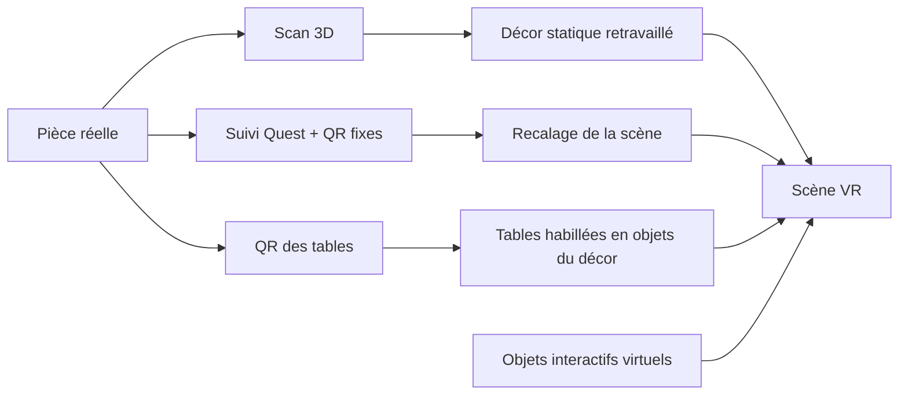

# Tohannic: No Way Out

> Escape game en **VR alignée avec une vraie pièce**, développé sur **Meta Quest 3**.

## Le concept

Le joueur explore une version virtuelle de la salle dans laquelle il se trouve. On peut changer complètement le thème du décor (médiéval, laboratoire, fantastique…), mais **les dimensions et la position des éléments physiques restent cohérentes**.

Le jeu repose sur trois éléments :

| Élément                | Dans la vraie salle                       | Dans le casque                                                 |
| ---------------------- | ----------------------------------------- | -------------------------------------------------------------- |
| **Décor statique**     | Sol, murs, plafond                        | Décor 3D issu d'un scan, retravaillé dans Blender              |
| **Tables amovibles**   | Tables sur roulettes, disposées librement | Éléments du décor à la même position : autels, blocs, bureaux… |
| **Objets interactifs** | Rien à manipuler physiquement             | Indices et mécanismes entièrement virtuels                     |

Les énigmes ne sont pas encore définies. L'objectif est d'abord d'avoir un environnement cohérent et des interactions qui fonctionnent.

## Fonctionnement général

## Les choix retenus

- **Une seule pièce** pour commencer, sans couloir obligatoire.
- **VR** pour l'affichage principal. La MR reste une extension.
- Scan 3D de la salle, sans intégrer définitivement les tables mobiles au décor.
- Suivi spatial natif du Quest, complété par les **QR codes fixes** pour recaler la pièce au fil de l'utilisation.
- Détection des **tables par leurs propres QR codes avant chaque partie**. Leur position peut changer d'une partie à l'autre.
- Chaque table est **remplacée visuellement par un modèle adapté au thème du décor**, dès le MVP 1.
- Objets à manipuler **uniquement virtuels**. Les interactions exactes restent à valider.

## Les deux MVP

| MVP                 | Objectif                                                                                                     |
| ------------------- | ------------------------------------------------------------------------------------------------------------ |
| **MVP 1 — INF3001** | Salle VR alignée, tables détectées et transformées visuellement, objets interactifs et courte boucle de jeu. |
| **MVP 2 — INF3002** | Monstre animé, navigation entre les obstacles, perception et comportement selon ses états.                   |

Le déroulement détaillé est dans la [roadmap](roadmap.md).

## Documentation

- [Architecture](architecture.md) — les trois catégories d'objets et le recalage.
- [Roadmap](roadmap.md) — toutes les phases des MVP 1 et 2.
- [Extensions](extensions.md) — les fonctionnalités qu'on garde pour plus tard.
- [Animations du monstre](monster_animations.md) — document de référence, inchangé.

- [Assets](assets.md) — les ressources communes aux MVP.
- [Idées d’énigmes](puzzles.md) — les propositions de l’équipe, sans choix imposé.
