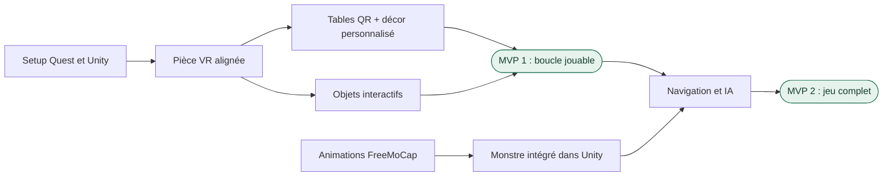

# Roadmap

Deux étapes : **MVP 1 (INF3001)** pour la VR alignée et les interactions, puis **MVP 2 (INF3002)** pour le monstre. Les énigmes précises ne sont pas encore choisies : on commence par valider les systèmes qui serviront au jeu.

## Vue d'ensemble

| MVP 1 — INF3001                            | MVP 2 — INF3002                                         |
| ------------------------------------------ | ------------------------------------------------------- |
| **0.** Setup Quest et Unity                | **5.** Production des animations avec FreeMoCap         |
| **1.** Scan, décor et recalage de la pièce | **6.** Préparation et intégration du monstre dans Unity |
| **2.** Tables, QR codes et habillage 3D    | **7.** Navigation et IA                                 |
| **3.** Interactions virtuelles             | **8.** Intégration et tests finaux                      |
| **4.** Boucle de jeu sans monstre          |                                                         |

La production des animations peut commencer **en parallèle du MVP 1**. Son intégration au jeu arrive dans le MVP 2.

---

## MVP 1 — INF3001 : VR alignée et interactions

### Phase 0 — Setup technique

**But :** faire tourner une scène Unity sur le Quest 3.

- [ ] Configurer Unity, OpenXR, Meta XR et MRUK.
- [ ] Déployer une scène de test sur le casque.
- [ ] Vérifier le suivi spatial et les interactions de base.

**Validé quand :** la scène fonctionne directement sur Quest 3.

### Phase 1 — Scan, décor et recalage de la pièce

**But :** créer un décor VR aligné avec la salle réelle.

- [ ] Scanner la pièce, nettoyer le maillage et retirer les tables du décor statique.
- [ ] Créer une première version thématisée du décor, même simple.
- [ ] Séparer les modèles visibles des géométries de collision.
- [ ] Importer la scène dans Unity et l'aligner avec le suivi du Quest.
- [ ] Ajouter des QR codes fixes pour vérifier et corriger le recalage global.
- [ ] Tester la précision et la stabilité de l'alignement pendant une session.

**Validé quand :** le décor correspond à la pièce réelle et les QR codes fixes permettent de corriger son alignement.

### Phase 2 — Tables amovibles et habillage 3D

**But :** intégrer les tables à n'importe quelle disposition de départ et **les transformer visuellement en éléments du décor**.

- [ ] Identifier les tables, mesurer leurs dimensions et placer leurs QR codes.
- [ ] Détecter leur position et leur orientation avant chaque partie.
- [ ] Placer les modèles 3D correspondants (autels, bureaux, blocs…) à la bonne position.
- [ ] Utiliser des volumes de collision adaptés aux tables.
- [ ] Préparer ces volumes pour la navigation du monstre dans le MVP 2.
- [ ] Tester plusieurs dispositions sans en programmer une liste fixe.

**Validé quand :** chaque table est représentée par un élément du décor bien positionné, avec des collisions cohérentes, même si la disposition change entre deux parties.

> [!NOTE]
> Les tables sont calibrées au démarrage, puis restent fixes pendant le jeu. Leur suivi continu est une extension.

### Phase 3 — Interactions virtuelles

**But :** manipuler des objets qui n'existent que dans le jeu.

- [ ] Ajouter quelques objets virtuels de test.
- [ ] Choisir et tester une méthode de ciblage / sélection compatible Quest 3.
- [ ] Permettre de prendre, déplacer, tourner ou activer un objet selon son rôle.
- [ ] Vérifier que les objets restent au bon endroit dans la scène.

**Validé quand :** les interactions principales fonctionnent sur le casque. Le contenu des énigmes reste à choisir dans le [catalogue de propositions](puzzles.md).

### Phase 4 — Boucle de jeu MVP 1

**But :** avoir une petite partie jouable sans monstre.

- [ ] Enchaîner recalage de la pièce, détection des tables et lancement du jeu.
- [ ] Choisir une ou plusieurs idées dans le [catalogue d’énigmes](puzzles.md), puis ajouter une progression simple avec ces objets.
- [ ] Définir une condition de victoire et la possibilité de recommencer.
- [ ] Tester plusieurs dispositions de tables et une partie complète sur Quest 3.

**MVP 1 validé quand :** on peut terminer une courte partie dans un décor VR aligné, avec tables transformées visuellement et objets virtuels interactifs.

---

## MVP 2 — INF3002 : animations, monstre et IA

Le MVP 2 reprend **la même pièce et les mêmes obstacles**. La référence pour les clips et les transitions est [monster_animations.md](monster_animations.md), conservé tel quel.

### Phase 5 — Production des animations

**But :** produire toutes les animations prévues pour le monstre avec **FreeMoCap**, puis les préparer pour Unity.

- [ ] Reprendre le graphe d'états et la liste des mouvements de `monster_animations.md`.
- [ ] Capturer les mouvements du catalogue avec FreeMoCap.
- [ ] Nettoyer et préparer les animations pour le personnage.
- [ ] Vérifier les transitions et la cohérence des clips.

**Validé quand :** les animations prévues sont exploitables pour l'intégration. Cette phase peut avancer en parallèle du MVP 1.

### Phase 6 — Préparation et intégration du monstre

**But :** avoir un personnage correctement animé dans Unity.

- [ ] Importer et vérifier le modèle 3D, le rig, le skinning et les matériaux.
- [ ] Adapter les animations au squelette du monstre (retargeting si nécessaire).
- [ ] Intégrer les clips et leurs transitions dans Unity.
- [ ] Tester les mouvements et les déformations du personnage.

**Validé quand :** le monstre joue les animations prévues dans la scène, sans problème majeur de rig ou de transition.

### Phase 7 — Navigation, perception et IA

**But :** faire réagir le monstre au joueur et contourner les obstacles.

- [ ] Préparer la navigation avec les murs et les tables détectées au début de partie.
- [ ] Mettre en place le pathfinding pour contourner les tables, quelle que soit leur disposition.
- [ ] Détecter le joueur à partir de sa position et de tests de visibilité.
- [ ] Relier les comportements à la machine à états : patrouille, poursuite, perte de vue, recherche, retour, capture.
- [ ] Déclencher les animations correspondant aux états du monstre.

**Validé quand :** le monstre se déplace et change de comportement selon la situation, sans traverser les obstacles de la scène.

### Phase 8 — Intégration et tests finaux

**But :** réunir le gameplay du MVP 1 et le monstre.

- [ ] Ajouter le monstre à la boucle de jeu.
- [ ] Gérer la capture du joueur et la défaite.
- [ ] Tester le monstre avec différentes positions de tables.
- [ ] Vérifier animations, recalage, interactions et performances sur Quest 3.
- [ ] Corriger les problèmes bloquant une partie complète.

**MVP 2 validé quand :** le joueur peut gagner ou perdre une partie complète, avec un monstre animé qui navigue et réagit dans la pièce calibrée.

---

## Dépendances principales

| Élément                   | Dépend de                                 |
| ------------------------- | ----------------------------------------- |
| Tables et objets virtuels | Repère de la pièce                        |
| Navigation                | Géométrie statique + positions des tables |
| Monstre animé             | Animations produites + personnage préparé |
| IA en jeu                 | Navigation + perception + animations      |
| Partie complète           | MVP 1 + monstre intégré                   |

Les fonctionnalités hors MVP sont regroupées dans [extensions.md](extensions.md). Les ressources nécessaires sont listées dans [assets.md](assets.md).
